# Algorithm and Flowchart to Determine the Greatest of Two Numbers

### 1. Problem Understanding

We are given two numbers, say **A** and **B**. We must compare them and display which one is greater.

There are three possible situations:

- **A > B** → A is the greatest
- **B > A** → B is the greatest
- **A = B** → both numbers are equal

A **flowchart** represents this logic pictorially using standard symbols.

### 2. Key Concepts Used

| Concept | Explanation |
|---|---|
| Input | Read the two numbers A and B |
| Decision / condition | Compare A with B using `>` and `<` |
| Branching | Different paths for A > B, B > A and A = B |
| Output | Display the greatest number |
| Terminator | Start and Stop symbols |

**Flowchart symbols used**

| Symbol | Shape | Purpose in this flowchart |
|---|---|---|
| Terminator | Oval / rounded rectangle | Start and Stop |
| Input/Output | Parallelogram | Read A, B and print the result |
| Decision | Diamond | Compare A and B |
| Flow line | Arrow | Shows the direction of flow |

### 3. Algorithm (Step-by-Step)

1. Start.
2. Read two numbers **A** and **B**.
3. If **A > B**, then print "A is the greatest" and go to Step 6.
4. Else, if **B > A**, then print "B is the greatest" and go to Step 6.
5. Else, print "Both numbers are equal".
6. Stop.

### 4. Flowchart



<sub>Mermaid source: [`diagrams/answer1.mmd`](diagrams/answer1.mmd)</sub>

**Plain-text flowchart** (text fallback):

```text
START
  │
  ▼
[Read A, B]
  │
  ▼
<A > B ?> ──Yes──► [Print A is the greatest] ──┐
  │ No                                          │
  ▼                                             │
<B > A ?> ──Yes──► [Print B is the greatest] ──┤
  │ No                                          │
  ▼                                             │
[Print "Both are equal"] ──────────────────────┤
                                                ▼
                                              STOP
```

### 5. Flowchart Explanation

| Step | Symbol | What happens |
|---|---|---|
| 1 | Oval | The process starts |
| 2 | Parallelogram | The values of A and B are read from the user |
| 3 | Diamond | Checks whether A is greater than B |
| 4 | Parallelogram | If yes, A is printed as the greatest |
| 5 | Diamond | If no, checks whether B is greater than A |
| 6 | Parallelogram | If yes, B is printed as the greatest |
| 7 | Parallelogram | If neither is greater, both are equal |
| 8 | Oval | The process stops |

### 6. Dry Run

**Case 1: A = 25, B = 40**

| Step | Condition / Action | Result |
|---|---|---|
| 1 | Read A = 25, B = 40 | — |
| 2 | A > B? → 25 > 40 | No |
| 3 | B > A? → 40 > 25 | Yes |
| 4 | Print B is the greatest | 40 |
| 5 | Stop | — |

**Case 2: A = 50, B = 50**

| Step | Condition / Action | Result |
|---|---|---|
| 1 | Read A = 50, B = 50 | — |
| 2 | A > B? → 50 > 50 | No |
| 3 | B > A? → 50 > 50 | No |
| 4 | Print Both are equal | 50 = 50 |
| 5 | Stop | — |

### 7. Sample Input / Output

```
Enter first number : 25
Enter second number: 40
40 is the greatest.
```

```
Enter first number : 50
Enter second number: 50
Both numbers are equal.
```

### 8. Edge Cases

| Input | Output | Remark |
|---|---|---|
| A = 0, B = 0 | Both are equal | Zero is handled normally |
| A = −5, B = −10 | −5 is the greatest | Comparison works for negative numbers |
| A = 2.5, B = 2.7 | 2.7 is the greatest | Works for decimal numbers |
| A = 100, B = 100 | Both are equal | Equality branch is required |
| Very large numbers | Correct result | A flowchart has no data-type limit; a program should choose a suitable type |
| Non-numeric input | Invalid | A real program should validate the input |

### 9. Common Mistakes to Avoid

1. **Omitting the equality case** — if both numbers are equal, the flowchart must still produce a correct output.
2. **Using only one decision box carelessly** — a single "A > B?" check with an `else` prints B even when A = B, which is wrong unless ties are explicitly allowed to print either number.
3. **Interchanging the Yes/No branches** — always label the branches clearly.
4. **Forgetting the Start and Stop symbols** — every flowchart needs one Start and at least one Stop.
5. **Using a rectangle for input/output** — input/output must use a parallelogram.
6. **Missing flow arrows** — every symbol except Start must have an incoming arrow.

### 10. Alternative Version (Single Decision)

If ties may be reported as either number, one decision is enough:

```text
START
    Read A, B
    IF A > B THEN
        Print A
    ELSE
        Print B
    END IF
STOP
```

For a complete answer, use the three-branch version in Section 4 because it also reports equality.

### 11. Brief Result Table (for the lab record)

| A | B | Output |
|---|---|---|
| 25 | 40 | 40 is the greatest |
| 90 | 15 | 90 is the greatest |
| 50 | 50 | Both numbers are equal |
| −5 | −10 | −5 is the greatest |
| 2.5 | 2.7 | 2.7 is the greatest |

---

⬅️ [Back to questions](question.md)
