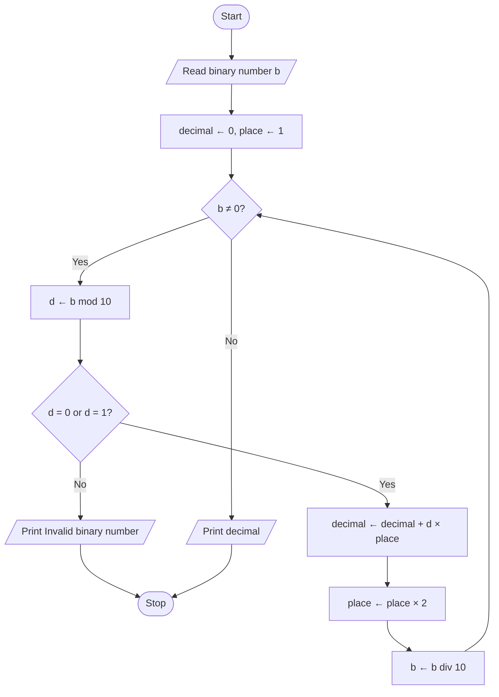

# Algorithm and Flowchart to Convert a Binary Number to Decimal

### 1. Problem Understanding

A **binary number** uses base 2 and contains only the digits **0** and **1**. A **decimal number** uses base 10.

Each binary digit (bit) has a place value that is a power of 2, starting from 2⁰ on the right:

```
Binary:   1    1    0    1
Place:    2³   2²   2¹   2⁰
Value:    8    4    2    1
```

To convert to decimal, multiply each bit by its place value and add the results:

```
1101₂ = 1×8 + 1×4 + 0×2 + 1×1 = 8 + 4 + 0 + 1 = 13₁₀
```

Examples:

| Binary | Decimal | Calculation |
|---|---|---|
| 0 | 0 | 0 |
| 1 | 1 | 1 |
| 10 | 2 | 1×2 + 0×1 |
| 101 | 5 | 1×4 + 0×2 + 1×1 |
| 1101 | 13 | 8 + 4 + 0 + 1 |
| 10110 | 22 | 16 + 0 + 4 + 2 + 0 |
| 11111111 | 255 | 128 + 64 + 32 + 16 + 8 + 4 + 2 + 1 |

### 2. Key Concepts Used

| Concept | Explanation |
|---|---|
| Base / radix | Binary has base 2; decimal has base 10 |
| Place value | Each bit is multiplied by a power of 2 |
| Modulus | `b mod 10` extracts the rightmost bit |
| Integer division | `b div 10` removes the rightmost bit |
| Accumulator | `decimal` stores the running total |
| Place multiplier | `place` starts at 1 and doubles each time |
| Input validation | Every digit must be 0 or 1 |

### 3. Algorithm (Step-by-Step)

1. Start.
2. Read the binary number **b**.
3. Set **decimal ← 0**, **place ← 1**.
4. While **b ≠ 0**:
   - **d ← b mod 10** (extract the rightmost bit).
   - If **d ≠ 0** and **d ≠ 1**, print "Invalid binary number" and stop.
   - **decimal ← decimal + d × place**
   - **place ← place × 2**
   - **b ← b div 10**
5. Print **decimal**.
6. Stop.

### 4. Flowchart



**Plain-text flowchart** (for viewers that do not render Mermaid):

```text
START
  │
  ▼
[Read binary number b]
  │
  ▼
[decimal ← 0, place ← 1]
  │
  ▼
<b ≠ 0 ?> ──Yes──► [d ← b mod 10]
  ▲                        │
  │                        ▼
  │                  <d = 0 or d = 1 ?>
  │                     │ No          │ Yes
  │                     ▼             ▼
  │          [Print "Invalid binary"] [decimal ← decimal + d × place]
  │                     │             │
  │                     ▼             ▼
  │                   STOP      [place ← place × 2]
  │                                   │
  │                                   ▼
  │                             [b ← b div 10]
  │                                   │
  │                                   └──► back to <b ≠ 0 ?>
  │ No
  ▼
[Print decimal]
  │
  ▼
STOP
```

### 5. Flowchart Explanation

| Step | Symbol | What happens |
|---|---|---|
| 1 | Oval | The process starts |
| 2 | Parallelogram | The binary number is read as an integer |
| 3 | Rectangle | The decimal result and place value are initialised |
| 4 | Diamond | Continues while bits remain |
| 5 | Rectangle | Extracts the rightmost bit |
| 6 | Diamond | Rejects any digit other than 0 or 1 |
| 7 | Rectangle | Adds the bit multiplied by its place value |
| 8 | Rectangle | Doubles the place value for the next bit |
| 9 | Rectangle | Removes the processed bit |
| 10 | Parallelogram | Prints the decimal result |
| 11 | Oval | The process stops |

### 6. Dry Run

**Input: b = 1101**

| Iteration | b | d = b mod 10 | place | decimal = decimal + d × place | b after div 10 | New place |
|---|---|---|---|---|---|---|
| Start | 1101 | 1 | 1 | 0 + 1×1 = 1 | 110 | 2 |
| 2 | 110 | 0 | 2 | 1 + 0×2 = 1 | 11 | 4 |
| 3 | 11 | 1 | 4 | 1 + 1×4 = 5 | 1 | 8 |
| 4 | 1 | 1 | 8 | 5 + 1×8 = 13 | 0 | 16 |
| 5 | 0 | — | — | Loop ends | — | — |

**Output:** `13`

**Input: b = 10110**

| Iteration | b | d | place | decimal | New b |
|---|---|---|---|---|---|
| 1 | 10110 | 0 | 1 | 0 | 1011 |
| 2 | 1011 | 1 | 2 | 2 | 101 |
| 3 | 101 | 1 | 4 | 6 | 10 |
| 4 | 10 | 0 | 8 | 6 | 1 |
| 5 | 1 | 1 | 16 | 22 | 0 |

**Output:** `22`

### 7. Sample Input / Output

```
Enter a binary number: 1101
Decimal equivalent = 13
```

```
Enter a binary number: 10110
Decimal equivalent = 22
```

```
Enter a binary number: 1021
Invalid binary number! Use only 0 and 1.
```

### 8. Edge Cases

| Input | Result | Remark |
|---|---|---|
| 0 | 0 | Zero in binary is zero in decimal |
| 1 | 1 | Smallest non-zero binary |
| 10 | 2 | Trailing zero is handled by place value |
| 0001101 | 13 | Leading zeros do not change the value |
| 1021 | Invalid | 2 is not a binary digit |
| Very long binary | Large decimal | Use a wide integer type |
| Negative sign | Not standard | Binary integers are usually unsigned |

### 9. Common Mistakes to Avoid

1. **Reversing the place values** — the rightmost bit must be multiplied by 1, the next by 2, then 4, 8, …
2. **Forgetting to double `place`** — the conversion then treats every bit as position 0.
3. **Using base 10 arithmetic on the bits incorrectly** — the input looks like a decimal number, but each digit must be interpreted in base 2.
4. **Not validating the digits** — a number such as 1021 is not binary.
5. **Processing digits from left to right without adjusting place values** — if you do, use Horner's method instead (see Section 10).
6. **Overflow for long binary strings** — use `long long`, `BigInteger`, or a string-based method.
7. **Confusing binary input with a decimal integer** — `1101` entered as an integer is still interpreted digit by digit here.

### 10. Alternative Versions

**Horner's method (left to right):**

Process each digit from left to right with `decimal = decimal × 2 + digit`.

```text
START
    Read binary string s
    decimal ← 0
    FOR each character c IN s DO
        IF c is not '0' and c is not '1' THEN
            Print Invalid; STOP
        END IF
        decimal ← decimal × 2 + (integer value of c)
    END FOR
    Print decimal
STOP
```

Example: `1101`

```
decimal = 0
decimal = 0×2 + 1 = 1
decimal = 1×2 + 1 = 3
decimal = 3×2 + 0 = 6
decimal = 6×2 + 1 = 13
```

**Positional expansion:**

```text
1101₂ = 1×2³ + 1×2² + 0×2¹ + 1×2⁰ = 13
```

**Using a built-in function (e.g. Python):**

```python
binary = input("Enter a binary number: ")
print(int(binary, 2))
```

### 11. Brief Result Table (for the lab record)

| Binary | Decimal |
|---|---|
| 0 | 0 |
| 1 | 1 |
| 10 | 2 |
| 11 | 3 |
| 101 | 5 |
| 1101 | 13 |
| 10110 | 22 |
| 11111111 | 255 |
| 100000000 | 256 |

---

⬅️ [Back to questions](question.md)
