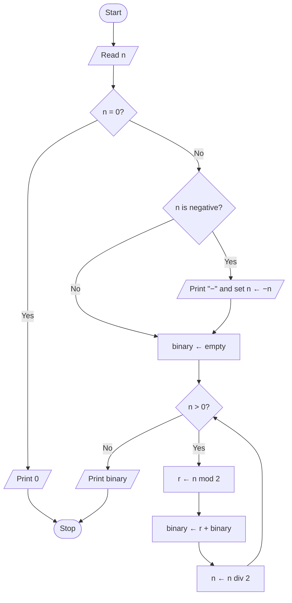

# Algorithm and Flowchart to Convert a Decimal Number to Binary

### 1. Problem Understanding

A **decimal number** uses base 10, while a **binary number** uses base 2. To convert a decimal integer to binary, we repeatedly divide the number by 2 and record the remainders.

The remainders are produced from **least significant bit to most significant bit**, so they must be read in **reverse order** (or prepended one by one).

Examples:

| Decimal | Division process | Binary |
|---|---|---|
| 0 | — | 0 |
| 1 | 1 ÷ 2 = 0, remainder 1 | 1 |
| 2 | 2 ÷ 2 = 1, rem 0; 1 ÷ 2 = 0, rem 1 | 10 |
| 5 | 5÷2=2 r1; 2÷2=1 r0; 1÷2=0 r1 | 101 |
| 10 | 10÷2=5 r0; 5÷2=2 r1; 2÷2=1 r0; 1÷2=0 r1 | 1010 |
| 13 | 13÷2=6 r1; 6÷2=3 r0; 3÷2=1 r1; 1÷2=0 r1 | 1101 |
| 25 | 25÷2=12 r1; 12÷2=6 r0; 6÷2=3 r0; 3÷2=1 r1; 1÷2=0 r1 | 11001 |

For **13**, the remainders are `1, 0, 1, 1` from bottom to top, giving `1101`.

### 2. Key Concepts Used

| Concept | Explanation |
|---|---|
| Base conversion | Decimal (base 10) → binary (base 2) |
| Repeated division | Divide by 2 until the quotient becomes 0 |
| Remainder | `n mod 2` gives the next binary digit |
| Quotient | `n div 2` gives the next number to divide |
| Reverse order | The first remainder is the last (rightmost) bit |
| String prepending | Adding each new bit to the front builds the answer directly |
| Zero handling | 0 is a special case and must be printed as `0` |

### 3. Algorithm (Step-by-Step)

1. Start.
2. Read the integer **n**.
3. If **n = 0**, print `0` and stop.
4. If **n < 0**, print a minus sign and set **n ← −n**.
5. Set **binary ← ""** (an empty string).
6. While **n > 0**:
   - **r ← n mod 2**
   - **binary ← r + binary** (prepend the remainder)
   - **n ← n div 2**
7. Print **binary**.
8. Stop.

> **Alternative:** store the remainders in an array and print the array in reverse order.

### 4. Flowchart



**Plain-text flowchart** (for viewers that do not render Mermaid):

```text
START
  │
  ▼
[Read n]
  │
  ▼
<n = 0 ?> ──Yes──► [Print 0] ──► STOP
  │ No
  ▼
<n < 0 ?> ──Yes──► [Print "−", n ← −n] ──┐
  │ No                                     │
  ▼                                        │
[binary ← ""] ◄────────────────────────────┘
  │
  ▼
<n > 0 ?> ──Yes──► [r ← n mod 2]
  ▲                        │
  │                        ▼
  │                  [binary ← r + binary]
  │                        │
  │                        ▼
  │                  [n ← n div 2]
  │                        │
  │                        └──► back to <n > 0 ?>
  │ No
  ▼
[Print binary]
  │
  ▼
STOP
```

### 5. Flowchart Explanation

| Step | Symbol | What happens |
|---|---|---|
| 1 | Oval | The process starts |
| 2 | Parallelogram | The decimal integer n is read |
| 3 | Diamond | Handles the special case n = 0 |
| 4 | Diamond | Checks for a negative number |
| 5 | Parallelogram | Prints a minus sign and makes n positive |
| 6 | Rectangle | Initialises the binary string |
| 7 | Diamond | Continues while n is greater than 0 |
| 8 | Rectangle | Computes the remainder `n mod 2` |
| 9 | Rectangle | Prepends the remainder to the binary string |
| 10 | Rectangle | Divides n by 2, discarding the remainder |
| 11 | Parallelogram | Prints the completed binary string |
| 12 | Oval | The process stops |

### 6. Dry Run

**Input: n = 13**

| Iteration | n | r = n mod 2 | binary after prepend | n after div 2 |
|---|---|---|---|---|
| Start | 13 | 1 | "1" | 6 |
| 2 | 6 | 0 | "01" | 3 |
| 3 | 3 | 1 | "101" | 1 |
| 4 | 1 | 1 | "1101" | 0 |
| 5 | 0 | — | Loop ends | — |

**Output:** `1101`

**Input: n = 10**

| Iteration | n | r | binary | New n |
|---|---|---|---|---|
| 1 | 10 | 0 | "0" | 5 |
| 2 | 5 | 1 | "10" | 2 |
| 3 | 2 | 0 | "010" | 1 |
| 4 | 1 | 1 | "1010" | 0 |

**Output:** `1010`

**Input: n = 0**

The special case prints `0` immediately.

### 7. Sample Input / Output

```
Enter a decimal number: 13
Binary equivalent = 1101
```

```
Enter a decimal number: 10
Binary equivalent = 1010
```

```
Enter a decimal number: 0
Binary equivalent = 0
```

### 8. Edge Cases

| Input | Output | Remark |
|---|---|---|
| 0 | 0 | Special case; the loop would produce an empty string |
| 1 | 1 | Single remainder |
| 2 | 10 | Power of 2 |
| 8 | 1000 | Power of 2 |
| 255 | 11111111 | 8 bits, all ones |
| 256 | 100000000 | 9 bits |
| −13 | −1101 | Sign is handled separately |
| Very large number | Long binary string | Use a string/array, not a fixed-size integer |
| Decimal fraction (e.g. 2.5) | Not handled | Requires fractional conversion (multiply by 2) |

### 9. Common Mistakes to Avoid

1. **Printing remainders in the wrong order** — the first remainder is the *last* bit, so the result must be reversed or prepended.
2. **Forgetting to handle n = 0** — the loop does not run, and an empty output is wrong; print `0` explicitly.
3. **Not dividing n** — forgetting `n = n div 2` creates an infinite loop.
4. **Using the remainder incorrectly** — the bit is `n mod 2`, not `n / 2`.
5. **Treating the result as a number** — leading zeros matter in strings; store the binary as a string or array.
6. **Ignoring negative numbers** — decide on a representation (sign + magnitude) before coding.
7. **Overflow when storing the binary as an integer** — binary representations grow much faster than decimal ones.

### 10. Alternative Versions

**Using an array and reversing it:**

```text
START
    Read n
    IF n = 0 THEN Print 0; STOP
    bits ← empty list
    WHILE n > 0 DO
        append (n mod 2) to bits
        n ← n div 2
    END WHILE
    FOR i ← length(bits) - 1 DOWNTO 0 DO
        Print bits[i]
    END FOR
STOP
```

**Recursive version:**

```text
FUNCTION print_binary(n)
    IF n > 1 THEN
        print_binary(n div 2)
    END IF
    Print (n mod 2)
END FUNCTION
```

**Subtraction of powers of 2:**

```text
Find the largest power of 2 ≤ n.
For each power of 2 from that value down to 1:
    if power ≤ n, print 1 and subtract it from n
    else print 0
```

**Using a built-in function (e.g. Python):**

```python
n = int(input("Enter a decimal number: "))
if n < 0:
    print("-" + bin(-n)[2:])
else:
    print(bin(n)[2:])
```

### 11. Brief Result Table (for the lab record)

| Decimal | Binary |
|---|---|
| 0 | 0 |
| 1 | 1 |
| 2 | 10 |
| 5 | 101 |
| 8 | 1000 |
| 10 | 1010 |
| 13 | 1101 |
| 25 | 11001 |
| 255 | 11111111 |
| 256 | 100000000 |

---

⬅️ [Back to questions](question.md)
