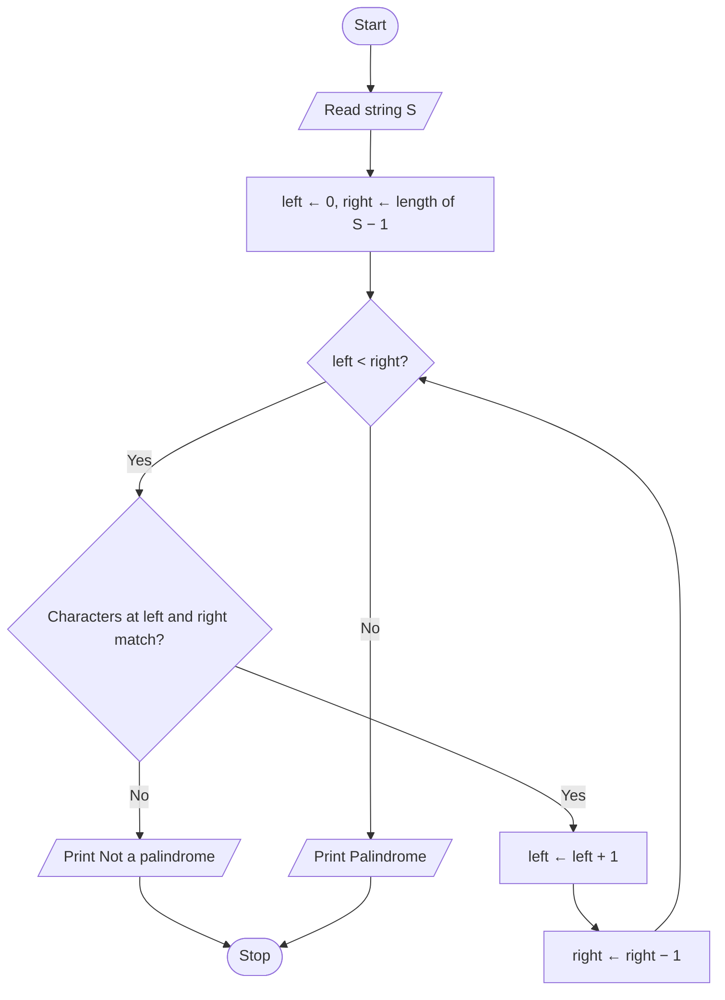

# Algorithm and Flowchart to Check Whether a Given String is a Palindrome

### 1. Problem Understanding

A **palindrome** is a string that reads the same forwards and backwards.

Examples:

| String | Reverse | Palindrome? |
|---|---|---|
| madam | madam | Yes |
| racecar | racecar | Yes |
| level | level | Yes |
| noon | noon | Yes |
| hello | olleh | No |
| algorithm | mhtirogla | No |
| malayalam | malayalam | Yes |
| 12321 | 12321 | Yes (numeric string) |
| "" (empty) | "" | Yes (by convention) |
| "a" | "a" | Yes |

The most efficient method uses **two pointers**:

- One pointer starts at the **left end**.
- The other starts at the **right end**.
- Characters at both pointers are compared.
- The pointers move inward until they meet or cross.

If any pair does not match, the string is **not** a palindrome.

### 2. Key Concepts Used

| Concept | Explanation |
|---|---|
| String | A sequence of characters |
| Indexing | `S[i]` gives the character at position i |
| Two pointers | `left` starts at 0; `right` starts at length − 1 |
| Loop | Continues while `left < right` |
| Character comparison | Checks whether `S[left] = S[right]` |
| Length | The number of characters in the string |
| Normalisation | Ignoring case, spaces and punctuation is an optional refinement |

### 3. Algorithm (Step-by-Step)

1. Start.
2. Read the string **S**.
3. Set **left ← 0** and **right ← length(S) − 1**.
4. While **left < right**:
   - If **S[left] ≠ S[right]**, print "Not a palindrome" and stop.
   - **left ← left + 1**
   - **right ← right − 1**
5. Print "Palindrome".
6. Stop.

> **Optional normalisation:** Before comparing, convert S to lowercase and remove spaces and punctuation if the palindrome should ignore them.

### 4. Flowchart



**Plain-text flowchart** (for viewers that do not render Mermaid):

```text
START
  │
  ▼
[Read string S]
  │
  ▼
[left ← 0, right ← length(S) − 1]
  │
  ▼
<left < right ?> ──Yes──► <S[left] = S[right] ?>
  ▲                          │ No                │ Yes
  │                          ▼                   ▼
  │                [Print "Not a palindrome"] [left ← left + 1]
  │                          │                   │
  │                          ▼                   ▼
  │                        STOP            [right ← right − 1]
  │                                              │
  │                                              └──► back to <left < right ?>
  │ No
  ▼
[Print "Palindrome"]
  │
  ▼
STOP
```

### 5. Flowchart Explanation

| Step | Symbol | What happens |
|---|---|---|
| 1 | Oval | The process starts |
| 2 | Parallelogram | The string S is read |
| 3 | Rectangle | The left pointer starts at 0 and the right pointer at the last index |
| 4 | Diamond | Continues while the pointers have not crossed |
| 5 | Diamond | Compares the characters at the two pointers |
| 6 | Parallelogram | If they differ, the string is not a palindrome and the process stops |
| 7 | Rectangle | Moves the left pointer one step right |
| 8 | Rectangle | Moves the right pointer one step left |
| 9 | Parallelogram | If all pairs match, the string is a palindrome |
| 10 | Oval | The process stops |

### 6. Dry Run

**Input: S = "madam"**

| Step | left | right | S[left] | S[right] | Match? | Action |
|---|---|---|---|---|---|---|
| 1 | 0 | 4 | m | m | Yes | left=1, right=3 |
| 2 | 1 | 3 | a | a | Yes | left=2, right=2 |
| 3 | 2 | 2 | — | — | — | left < right is false → stop (middle `d` is not compared) |

**Output:** `Palindrome`

**Input: S = "hello"**

| Step | left | right | S[left] | S[right] | Match? | Action |
|---|---|---|---|---|---|---|
| 1 | 0 | 4 | h | o | No | Print "Not a palindrome" |

**Output:** `Not a palindrome`

**Input: S = "racecar"**

| Step | left | right | Pair | Match? |
|---|---|---|---|---|
| 1 | 0 | 6 | r, r | Yes |
| 2 | 1 | 5 | a, a | Yes |
| 3 | 2 | 4 | c, c | Yes |
| 4 | 3 | 3 | — | left < right is false → stop (middle `e` is not compared) |

**Output:** `Palindrome`

### 7. Sample Input / Output

```
Enter a string: madam
"madam" is a palindrome.
```

```
Enter a string: hello
"hello" is not a palindrome.
```

```
Enter a string: racecar
"racecar" is a palindrome.
```

```
Enter a string: Malayalam
"Malayalam" is not a palindrome (case-sensitive).
```

### 8. Edge Cases

| Input | Result | Remark |
|---|---|---|
| "" (empty string) | Palindrome | By convention; the loop does not run |
| "a" | Palindrome | Single character |
| "ab" | Not palindrome | Two different characters |
| "aa" | Palindrome | Two equal characters |
| "Madam" | Not palindrome (case-sensitive) | Normalise case if required |
| "A man a plan a canal Panama" | Palindrome after normalisation | Ignore spaces and case |
| "12321" | Palindrome | Numeric string |
| "12345" | Not palindrome | — |
| Unicode text | Depends on encoding | Compare characters, not bytes |

### 9. Common Mistakes to Avoid

1. **Forgetting the case difference** — "Madam" is not a palindrome in a case-sensitive comparison. Convert to the same case first if needed.
2. **Ignoring spaces and punctuation** — "A man a plan a canal Panama" is a palindrome only after removing them.
3. **Off-by-one error in the right pointer** — the last character is at `length − 1`, not `length`.
4. **Using `left ≤ right` instead of `left < right`** — the middle character (odd length) is compared with itself, which is harmless but unnecessary; `left < right` is cleaner.
5. **Comparing the wrong indices** — always compare `S[left]` with `S[right]`.
6. **Not stopping after a mismatch** — the result is already decided; continuing wastes time.
7. **Modifying the string while iterating** — work on a copy or use immutable indexing.
8. **Assuming every language indexes from 0** — most do, but always confirm.

### 10. Alternative Versions

**Reverse-and-compare:**

```text
START
    Read string S
    R ← reverse of S
    IF S = R THEN Print Palindrome ELSE Print Not a palindrome
STOP
```

**Recursive version:**

```text
FUNCTION is_palindrome(S, left, right)
    IF left ≥ right THEN
        RETURN true
    END IF
    IF S[left] ≠ S[right] THEN
        RETURN false
    END IF
    RETURN is_palindrome(S, left + 1, right - 1)
END FUNCTION
```

**Using a stack:**

```text
Push the first half of the string onto a stack.
Compare each popped character with the second half.
If all match, it is a palindrome.
```

**Case-insensitive and ignoring non-letters:**

```text
START
    Read S
    T ← lowercase(S)
    T ← remove all characters except letters and digits from T
    Use the two-pointer method on T
STOP
```

### 11. Brief Result Table (for the lab record)

| String | Reverse | Result |
|---|---|---|
| madam | madam | Palindrome |
| racecar | racecar | Palindrome |
| level | level | Palindrome |
| noon | noon | Palindrome |
| hello | olleh | Not a palindrome |
| ab | ba | Not a palindrome |
| aa | aa | Palindrome |
| 12321 | 12321 | Palindrome |
| "a" | "a" | Palindrome |
| "" | "" | Palindrome |

---

⬅️ [Back to questions](question.md)
