# Algorithm and Flowchart to Check Whether a Given Number is a Palindrome

### 1. Problem Understanding

A **palindromic number** is a number that reads the same forwards and backwards.

Examples:

| Number | Reverse | Palindrome? |
|---|---|---|
| 121 | 121 | Yes |
| 12321 | 12321 | Yes |
| 4554 | 4554 | Yes |
| 7 | 7 | Yes |
| 0 | 0 | Yes |
| 123 | 321 | No |
| 120 | 21 | No |
| −121 | — | Usually not considered |

The idea is to **reverse the number** and compare the reversed value with the original value.

To reverse a number:

1. Extract the last digit with `n mod 10`.
2. Append it to the reversed number: `reverse = reverse × 10 + digit`.
3. Remove the last digit from n: `n = n div 10`.
4. Repeat until n becomes 0.

### 2. Key Concepts Used

| Concept | Explanation |
|---|---|
| Digit extraction | `n mod 10` gives the last digit |
| Digit removal | `n div 10` removes the last digit |
| Number reversal | Build the reverse by multiplying by 10 and adding the digit |
| Original value | Save `n` in `original` before modifying it |
| Comparison | Compare the reversed number with the original |
| Overflow | Reversing a large number can exceed the integer range |
| Negative numbers | Usually treated as non-palindromic |

### 3. Algorithm (Step-by-Step)

1. Start.
2. Read the integer **n**.
3. If **n < 0**, print "Not a palindrome" and stop.
4. Set **original ← n** and **reverse ← 0**.
5. While **n > 0**:
   - **d ← n mod 10**
   - **reverse ← reverse × 10 + d**
   - **n ← n div 10**
6. If **original = reverse**, print "Palindrome"; otherwise print "Not a palindrome".
7. Stop.

### 4. Flowchart



<sub>Mermaid source: [`diagrams/answer13.mmd`](diagrams/answer13.mmd)</sub>

**Plain-text flowchart** (text fallback):

```text
START
  │
  ▼
[Read n]
  │
  ▼
<n < 0 ?> ──Yes──► [Print "Not a palindrome"] ──► STOP
  │ No
  ▼
[original ← n, reverse ← 0]
  │
  ▼
<n > 0 ?> ──Yes──► [d ← n mod 10]
  ▲                        │
  │                        ▼
  │                  [reverse ← reverse × 10 + d]
  │                        │
  │                        ▼
  │                  [n ← n div 10]
  │                        │
  │                        └──► back to <n > 0 ?>
  │ No
  ▼
<original = reverse ?> ──Yes──► [Print "Palindrome"] ──┐
  │ No                                                   │
  ▼                                                      │
[Print "Not a palindrome"] ──────────────────────────────┤
                                                         ▼
                                                       STOP
```

### 5. Flowchart Explanation

| Step | Symbol | What happens |
|---|---|---|
| 1 | Oval | The process starts |
| 2 | Parallelogram | The integer n is read |
| 3 | Diamond | Negative numbers are rejected |
| 4 | Rectangle | The original value is saved and the reverse starts at 0 |
| 5 | Diamond | Continues while n has digits left |
| 6 | Rectangle | Extracts the last digit |
| 7 | Rectangle | Appends the digit to the reversed number |
| 8 | Rectangle | Removes the last digit from n |
| 9 | Diamond | Compares the reversed number with the original |
| 10 | Parallelogram | Prints whether the number is a palindrome |
| 11 | Oval | The process stops |

### 6. Dry Run

**Input: n = 12321**

| Iteration | n | d = n mod 10 | reverse = reverse × 10 + d | n after div 10 |
|---|---|---|---|---|
| Start | 12321 | 1 | 0×10 + 1 = 1 | 1232 |
| 2 | 1232 | 2 | 1×10 + 2 = 12 | 123 |
| 3 | 123 | 3 | 12×10 + 3 = 123 | 12 |
| 4 | 12 | 2 | 123×10 + 2 = 1232 | 1 |
| 5 | 1 | 1 | 1232×10 + 1 = 12321 | 0 |
| 6 | 0 | — | Loop ends | — |

`original = 12321`, `reverse = 12321` → **Palindrome**.

**Input: n = 123**

| Iteration | n | d | reverse | New n |
|---|---|---|---|---|
| 1 | 123 | 3 | 3 | 12 |
| 2 | 12 | 2 | 32 | 1 |
| 3 | 1 | 1 | 321 | 0 |

`original = 123`, `reverse = 321` → **Not a palindrome**.

**Input: n = 120**

| Iteration | n | d | reverse | New n |
|---|---|---|---|---|
| 1 | 120 | 0 | 0 | 12 |
| 2 | 12 | 2 | 2 | 1 |
| 3 | 1 | 1 | 21 | 0 |

`original = 120`, `reverse = 21` → **Not a palindrome**. (The trailing zero disappears, as expected.)

### 7. Sample Input / Output

```
Enter a number: 12321
12321 is a palindrome.
```

```
Enter a number: 123
123 is not a palindrome.
```

```
Enter a number: 7
7 is a palindrome.
```

```
Enter a number: -121
-121 is not a palindrome.
```

### 8. Edge Cases

| Input | Result | Remark |
|---|---|---|
| 0 | Palindrome | Single digit |
| 7 | Palindrome | Single-digit numbers are palindromic |
| 11 | Palindrome | Two equal digits |
| 10 | Not palindrome | Reverse is 1 |
| 120 | Not palindrome | Trailing zero is lost in the reverse |
| 1221 | Palindrome | Even number of digits |
| 12321 | Palindrome | Odd number of digits |
| −121 | Not palindrome | Negative numbers are normally excluded |
| Very large number | Possible overflow | Use `long long` or a string-based method |

### 9. Common Mistakes to Avoid

1. **Not saving the original number** — after the loop, n is 0, so the comparison would always fail.
2. **Reversing with the wrong formula** — use `reverse = reverse × 10 + digit`, not `reverse = reverse + digit`.
3. **Forgetting to remove the digit** — `n = n div 10` is essential.
4. **Ignoring trailing zeros** — the reverse of 120 is 21, so 120 is not a palindrome; this is correct.
5. **Treating negative numbers as palindromes** — −121 reversed is 121−, which is not the same; reject or handle explicitly.
6. **Overflow while reversing** — a 10-digit number may reverse to a value larger than a 32-bit integer can hold.
7. **Comparing strings with numbers** — decide on one representation and be consistent.
8. **Assuming leading zeros are allowed** — the reverse of 100 is 001, which as a number is 1.

### 10. Alternative Versions

**String-based comparison:**

```text
START
    Read n
    s ← convert n to string
    IF s = reverse(s) THEN Print Palindrome ELSE Print Not a palindrome
STOP
```

**Reversing only half the number (avoids overflow):**

```text
START
    Read n
    IF n < 0 OR (n mod 10 = 0 AND n ≠ 0) THEN
        Print Not a palindrome; STOP
    END IF
    reverse ← 0
    WHILE n > reverse DO
        reverse ← reverse × 10 + (n mod 10)
        n ← n div 10
    END WHILE
    IF n = reverse OR n = reverse div 10 THEN
        Print Palindrome
    ELSE
        Print Not a palindrome
    END IF
STOP
```

**Recursive version:**

```text
FUNCTION reverse_number(n, reverse)
    IF n = 0 THEN
        RETURN reverse
    END IF
    RETURN reverse_number(n div 10, reverse × 10 + (n mod 10))
END FUNCTION

Read n
IF n = reverse_number(n, 0) THEN Print Palindrome ELSE Print Not a palindrome
```

### 11. Brief Result Table (for the lab record)

| n | Reverse | Result |
|---|---|---|
| 0 | 0 | Palindrome |
| 7 | 7 | Palindrome |
| 11 | 11 | Palindrome |
| 121 | 121 | Palindrome |
| 1221 | 1221 | Palindrome |
| 12321 | 12321 | Palindrome |
| 123 | 321 | Not a palindrome |
| 120 | 21 | Not a palindrome |
| −121 | — | Not a palindrome |

---

⬅️ [Back to questions](question.md)
