# Algorithm and Flowchart to Print the Series 1/1! + 2/2! + 3/3! + ⋯ + n/n!

### 1. Problem Understanding

We must print and evaluate the series up to the **nth term**:

```
S = 1/1! + 2/2! + 3/3! + ... + n/n!
```

Since `1/1! = 1`, the series can also be written as:

```
S = 1 + 2/2! + 3/3! + ... + n/n!
```

Each term has the form:

```
term(i) = i / i!        for i = 1, 2, 3, ..., n
```

The series converges quickly. As n increases, the sum approaches **e ≈ 2.718281828…**, because:

```
Σ (i / i!) = Σ 1/(i − 1)! = e
```

Examples:

| n | Terms | Sum |
|---|---|---|
| 1 | 1/1! = 1 | 1.000000 |
| 2 | 1 + 2/2! = 1 + 1 | 2.000000 |
| 3 | 1 + 1 + 3/6 = 1 + 1 + 0.5 | 2.500000 |
| 4 | … + 4/24 = 0.166667 | 2.666667 |
| 5 | … + 5/120 = 0.041667 | 2.708333 |
| 6 | … + 6/720 = 0.008333 | 2.716667 |
| 10 | — | 2.718282 (approximately) |

### 2. Key Concepts Used

| Concept | Explanation |
|---|---|
| Series | An ordered sum of terms |
| Factorial | `i! = 1 × 2 × ... × i` |
| Term | `term = i / i!` |
| Accumulator | `sum` stores the running total |
| Running factorial | Update `fact = fact × i` in each iteration instead of recomputing it |
| Floating-point division | The result is a real number, not an integer |
| Loop | Repeats for i = 1 to n |

### 3. Algorithm (Step-by-Step)

1. Start.
2. Read the number of terms **n**.
3. If **n ≤ 0**, print "Invalid input" and stop.
4. Set **sum ← 0** and **fact ← 1**.
5. For **i ← 1 to n**:
   - **fact ← fact × i** (compute i!)
   - **term ← i ÷ fact** (real division, not integer division)
   - **sum ← sum + term**
   - Print **term** (optional, to display the series).
6. Print **sum**.
7. Stop.

### 4. Flowchart



<sub>Mermaid source: [`diagrams/answer14.mmd`](diagrams/answer14.mmd)</sub>

**Plain-text flowchart** (text fallback):

```text
START
  │
  ▼
[Read n]
  │
  ▼
<n ≤ 0 ?> ──Yes──► [Print "Invalid input"] ──► STOP
  │ No
  ▼
[sum ← 0, fact ← 1]
  │
  ▼
[i ← 1]
  │
  ▼
<i ≤ n ?> ──Yes──► [fact ← fact × i]
  ▲                        │
  │                        ▼
  │                  [term ← i / fact]
  │                        │
  │                        ▼
  │                  [sum ← sum + term]
  │                        │
  │                        ▼
  │                  [Print term]
  │                        │
  │                        ▼
  │                  [i ← i + 1]
  │                        │
  │                        └──► back to <i ≤ n ?>
  │ No
  ▼
[Print sum]
  │
  ▼
STOP
```

### 5. Flowchart Explanation

| Step | Symbol | What happens |
|---|---|---|
| 1 | Oval | The process starts |
| 2 | Parallelogram | The number of terms n is read |
| 3 | Diamond | Rejects n ≤ 0 |
| 4 | Rectangle | Initialises the sum to 0 and the factorial to 1 |
| 5 | Rectangle | The counter i starts at 1 |
| 6 | Diamond | Continues while i ≤ n |
| 7 | Rectangle | Computes i! incrementally |
| 8 | Rectangle | Computes the current term `i / i!` |
| 9 | Rectangle | Adds the term to the running sum |
| 10 | Parallelogram | Prints the current term (optional) |
| 11 | Rectangle | Increments i |
| 12 | Parallelogram | Prints the final sum |
| 13 | Oval | The process stops |

### 6. Dry Run

**Input: n = 5**

| Iteration | i | fact = fact × i | term = i / fact | sum = sum + term |
|---|---|---|---|---|
| Start | 1 | 1 × 1 = 1 | 1 / 1 = 1.000000 | 0 + 1.000000 = 1.000000 |
| 2 | 2 | 1 × 2 = 2 | 2 / 2 = 1.000000 | 1.000000 + 1.000000 = 2.000000 |
| 3 | 3 | 2 × 3 = 6 | 3 / 6 = 0.500000 | 2.000000 + 0.500000 = 2.500000 |
| 4 | 4 | 6 × 4 = 24 | 4 / 24 = 0.166667 | 2.500000 + 0.166667 = 2.666667 |
| 5 | 5 | 24 × 5 = 120 | 5 / 120 = 0.041667 | 2.666667 + 0.041667 = 2.708333 |
| 6 | 6 | — | Loop ends | — |

**Output:**

```
1.000000 + 1.000000 + 0.500000 + 0.166667 + 0.041667
Sum = 2.708333
```

**Input: n = 1**

The loop runs once: `sum = 1`. Output `1.000000`.

**Input: n = 3**

```
1/1! = 1
2/2! = 1
3/3! = 0.5
Sum = 2.5
```

### 7. Sample Input / Output

```
How many terms? 5
Series: 1.000000 + 1.000000 + 0.500000 + 0.166667 + 0.041667
Sum of the series = 2.708333
```

```
How many terms? 3
Series: 1.000000 + 1.000000 + 0.500000
Sum of the series = 2.500000
```

```
How many terms? 0
Invalid input! n must be a positive integer.
```

### 8. Edge Cases

| Input | Result | Remark |
|---|---|---|
| n = 0 | Invalid input | At least one term is required |
| n = 1 | 1.000000 | Only the first term |
| n = 2 | 2.000000 | 1 + 1 |
| n = 5 | 2.708333 | Standard example |
| n = 10 | ≈ 2.718282 | Close to e |
| n < 0 | Invalid input | Negative term count |
| Very large n | ≈ e (mathematically) | The sum approaches e, but factorials overflow fixed-width types |
| Integer division used by mistake | Wrong result | Terms such as 3/6 become 0 |
| Decimal n | Invalid | The number of terms must be an integer |

### 9. Common Mistakes to Avoid

1. **Using integer division** — `i / fact` must be a floating-point division; otherwise many terms become 0.
2. **Recomputing the factorial from scratch** — updating `fact = fact × i` each iteration is simpler and faster.
3. **Updating the factorial in the wrong order** — compute `fact` before `term` so that `term` uses the correct i!.
4. **Starting the series at i = 0** — `0/0!` adds 0 and changes the term count; the stated series starts at 1.
5. **Resetting `fact` inside the loop** — the running factorial must carry forward.
6. **Forgetting to add the term to the sum** — computing terms without accumulating them is a common slip.
7. **Overflow of the factorial** — 21! already exceeds a signed 64-bit integer (20! still fits); use floating-point or a big-integer type for large n.
8. **Rounding the printed sum too early** — keep full precision during accumulation and round only for display.

### 10. Alternative Versions

**Using the recurrence between terms (avoids large factorials):**

Since `term(i) = i / i!` and `term(i − 1) = (i − 1)/(i − 1)!`:

```
term(i) = term(i − 1) / (i − 1)     for i ≥ 2, with term(1) = 1
```

```text
START
    Read n
    IF n ≤ 0 THEN Print error; STOP
    sum ← 1
    term ← 1
    FOR i ← 2 TO n DO
        term ← term / (i - 1)
        sum ← sum + term
    END FOR
    Print sum
STOP
```

**Using `1/(i − 1)!` directly:**

```text
sum ← 0
fact ← 1
FOR i ← 1 TO n DO
    sum ← sum + 1 / fact
    fact ← fact × i
END FOR
Print sum
```

**Using a built-in factorial function (e.g. Python):**

```python
import math

n = int(input("How many terms? "))
total = sum(i / math.factorial(i) for i in range(1, n + 1))
print(f"Sum = {total:.6f}")
```

**Displaying the terms as a formatted series:**

```python
n = int(input("How many terms? "))
total = 0
fact = 1
terms = []
for i in range(1, n + 1):
    fact *= i
    term = i / fact
    total += term
    terms.append(f"{term:.6f}")
print(" + ".join(terms))
print(f"Sum = {total:.6f}")
```

### 11. Brief Result Table (for the lab record)

| n | Series | Sum |
|---|---|---|
| 1 | 1/1! | 1.000000 |
| 2 | 1/1! + 2/2! | 2.000000 |
| 3 | 1/1! + 2/2! + 3/3! | 2.500000 |
| 4 | … + 4/4! | 2.666667 |
| 5 | … + 5/5! | 2.708333 |
| 6 | … + 6/6! | 2.716667 |
| 10 | … + 10/10! | 2.718282 (≈ e) |

---

⬅️ [Back to questions](question.md)
