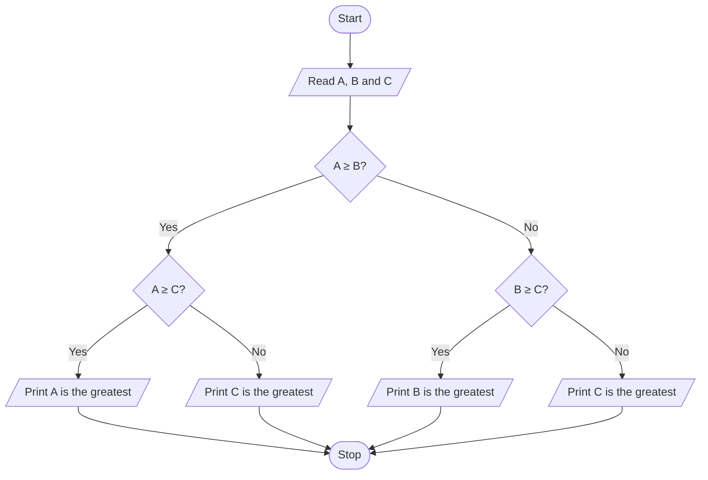

# Algorithm and Flowchart to Determine the Greatest of Three Numbers

### 1. Problem Understanding

We are given three numbers **A**, **B** and **C**. We must find and display the largest of the three.

The logic is an extension of the "greatest of two" problem:

1. Compare A with B and C.
2. If A is greater than or equal to both, A is the greatest.
3. Otherwise, compare B with C.
4. The larger of B and C is the greatest.

Using **≥** (greater than or equal to) instead of **>** makes the flowchart work correctly when two or all three numbers are equal.

### 2. Key Concepts Used

| Concept | Explanation |
|---|---|
| Multiple decisions | More than one diamond is needed to compare three values |
| Nested decision | One decision lies inside the branch of another decision |
| Compound condition | `A ≥ B AND A ≥ C` checks both comparisons together |
| Logical AND | The result is true only when **both** conditions are true |
| Equality handling | `≥` ensures ties are reported correctly |

### 3. Algorithm (Step-by-Step)

1. Start.
2. Read three numbers **A**, **B** and **C**.
3. If **A ≥ B** and **A ≥ C**, then print "A is the greatest" and go to Step 7.
4. Else, if **B ≥ C**, then print "B is the greatest" and go to Step 7.
5. Else, print "C is the greatest".
6. (End of the decision structure.)
7. Stop.

### 4. Flowchart



**Plain-text flowchart** (for viewers that do not render Mermaid):

```text
START
  │
  ▼
[Read A, B, C]
  │
  ▼
<A ≥ B ?> ──No──► <B ≥ C ?> ──Yes──► [Print B] ──┐
  │ Yes                │ No                       │
  ▼                    ▼                          │
<A ≥ C ?>          [Print C] ─────────────────────┤
  │ Yes    │ No                                   │
  ▼        ▼                                      │
[Print A] [Print C] ──────────────────────────────┤
  │                                               │
  └──────────────────────┬────────────────────────┘
                         ▼
                       STOP
```

### 5. Flowchart Explanation

| Step | Symbol | What happens |
|---|---|---|
| 1 | Oval | The process starts |
| 2 | Parallelogram | The three numbers A, B and C are read |
| 3 | Diamond | Checks whether A is greater than or equal to B |
| 4 | Diamond | If yes, checks whether A is also greater than or equal to C |
| 5 | Parallelogram | If both checks are true, A is the greatest |
| 6 | Parallelogram | If A ≥ B but A < C, then C is the greatest |
| 7 | Diamond | If A < B, checks whether B is greater than or equal to C |
| 8 | Parallelogram | If yes, B is the greatest; otherwise C is the greatest |
| 9 | Oval | The process stops |

### 6. Dry Run

**Case 1: A = 15, B = 42, C = 27**

| Step | Condition / Action | Result |
|---|---|---|
| 1 | Read A = 15, B = 42, C = 27 | — |
| 2 | A ≥ B? → 15 ≥ 42 | No |
| 3 | B ≥ C? → 42 ≥ 27 | Yes |
| 4 | Print B is the greatest | 42 |
| 5 | Stop | — |

**Case 2: A = 30, B = 20, C = 30**

| Step | Condition / Action | Result |
|---|---|---|
| 1 | Read A = 30, B = 20, C = 30 | — |
| 2 | A ≥ B? → 30 ≥ 20 | Yes |
| 3 | A ≥ C? → 30 ≥ 30 | Yes |
| 4 | Print A is the greatest | 30 |
| 5 | Stop | — |

**Case 3: A = −5, B = −9, C = −2**

| Step | Condition / Action | Result |
|---|---|---|
| 1 | Read A = −5, B = −9, C = −2 | — |
| 2 | A ≥ B? → −5 ≥ −9 | Yes |
| 3 | A ≥ C? → −5 ≥ −2 | No |
| 4 | Print C is the greatest | −2 |
| 5 | Stop | — |

### 7. Sample Input / Output

```
Enter first number : 15
Enter second number: 42
Enter third number : 27
42 is the greatest.
```

```
Enter first number : 30
Enter second number: 20
Enter third number : 30
30 is the greatest.
```

### 8. Edge Cases

| Input | Output | Remark |
|---|---|---|
| A = B = C = 10 | 10 is the greatest | All equal; the first branch handles it |
| A = 5, B = 5, C = 2 | 5 is the greatest | Two equal values |
| A = 5, B = 9, C = 9 | 9 is the greatest | B ≥ C is true |
| Negative numbers | Correct result | Comparison works with negatives |
| Decimal numbers | Correct result | Works with real numbers |
| Zero and negative values | Correct result | Zero is greater than any negative number |
| Non-numeric input | Invalid | Validate input in a real program |

### 9. Common Mistakes to Avoid

1. **Comparing only A and B** — all three numbers must be considered.
2. **Using `>` instead of `≥`** — ties can then be missed or reported incorrectly.
3. **Writing `A ≥ B ≥ C`** — this is not valid in most languages; use `A ≥ B AND A ≥ C`.
4. **Wrong nesting** — the second comparison must be inside the correct branch.
5. **Forgetting one of the possible outputs** — there must be an output for every path.
6. **Missing Start/Stop symbols** — every flowchart needs them.
7. **Using the wrong symbol for input/output** — use a parallelogram, not a rectangle.

### 10. Alternative Versions

**Using a `max` function (pseudocode):**

```text
START
    Read A, B, C
    greatest ← max(A, max(B, C))
    Print greatest
STOP
```

**Using sorting (pseudocode):**

```text
START
    Read A, B, C
    IF A > B THEN swap A and B
    IF B > C THEN swap B and C
    IF A > B THEN swap A and B
    Print C
STOP
```

**Using a single compound decision:**

```text
START
    Read A, B, C
    IF A ≥ B AND A ≥ C THEN
        Print A
    ELSE IF B ≥ C THEN
        Print B
    ELSE
        Print C
    END IF
STOP
```

### 11. Brief Result Table (for the lab record)

| A | B | C | Output |
|---|---|---|---|
| 15 | 42 | 27 | 42 |
| 90 | 15 | 60 | 90 |
| 30 | 20 | 30 | 30 |
| −5 | −9 | −2 | −2 |
| 7 | 7 | 7 | 7 |
| 2.5 | 2.7 | 2.1 | 2.7 |

---

⬅️ [Back to questions](question.md)
