# Algorithm and Flowchart to Calculate the Factorial of a Given Integer

### 1. Problem Understanding

The **factorial** of a non-negative integer **n**, written as **n!**, is the product of all positive integers from 1 to n:

```
n! = 1 × 2 × 3 × ... × n
```

Special case:

```
0! = 1        (by definition)
```

Factorial is **not defined** for negative integers. Therefore, the flowchart must reject negative input.

Examples:

| n | n! |
|---|---|
| 0 | 1 |
| 1 | 1 |
| 3 | 6 |
| 5 | 120 |
| 7 | 5040 |

### 2. Key Concepts Used

| Concept | Explanation |
|---|---|
| Accumulator | `fact` stores the running product |
| Initialisation | `fact = 1` because 1 is the multiplicative identity |
| Counter | `i` runs from 1 up to n |
| Loop | The multiplication repeats n times |
| Input validation | Negative values are rejected before the loop |
| Overflow | n! grows very quickly; large n needs a bigger data type |

### 3. Algorithm (Step-by-Step)

1. Start.
2. Read the integer **n**.
3. If **n < 0**, then print "Factorial is not defined for negative integers" and stop.
4. Set **fact ← 1**.
5. Set **i ← 1**.
6. While **i ≤ n**:
   - **fact ← fact × i**
   - **i ← i + 1**
7. Print **fact**.
8. Stop.

### 4. Flowchart



<sub>Mermaid source: [`diagrams/answer3.mmd`](diagrams/answer3.mmd)</sub>

**Plain-text flowchart** (text fallback):

```text
START
  │
  ▼
[Read n]
  │
  ▼
<n < 0 ?> ──Yes──► [Print "Invalid input"] ──► STOP
  │ No
  ▼
[fact ← 1, i ← 1]
  │
  ▼
<i ≤ n ?> ──Yes──► [fact ← fact × i]
  │                    │
  │                    ▼
  │              [i ← i + 1]
  │                    │
  │                    └──────────► back to <i ≤ n ?>
  │ No
  ▼
[Print fact]
  │
  ▼
STOP
```

### 5. Flowchart Explanation

| Step | Symbol | What happens |
|---|---|---|
| 1 | Oval | The process starts |
| 2 | Parallelogram | The integer n is read |
| 3 | Diamond | Checks whether n is negative |
| 4 | Parallelogram | If negative, an error message is printed and the process stops |
| 5 | Rectangle | `fact` is initialised to 1 and `i` to 1 |
| 6 | Diamond | Checks whether the counter i is still within range |
| 7 | Rectangle | Multiplies the current factorial by i |
| 8 | Rectangle | Increments i by 1 |
| 9 | Parallelogram | When the loop ends, the final factorial is printed |
| 10 | Oval | The process stops |

### 6. Dry Run

**Input: n = 5**

| Iteration | i | i ≤ 5? | fact = fact × i | i after increment |
|---|---|---|---|---|
| Start | 1 | Yes | 1 × 1 = 1 | 2 |
| 1 | 2 | Yes | 1 × 2 = 2 | 3 |
| 2 | 3 | Yes | 2 × 3 = 6 | 4 |
| 3 | 4 | Yes | 6 × 4 = 24 | 5 |
| 4 | 5 | Yes | 24 × 5 = 120 | 6 |
| 5 | 6 | No | Loop ends | — |

**Output:** `5! = 120`

**Input: n = 0**

| Step | Action | Result |
|---|---|---|
| 1 | n = 0, not negative | Continue |
| 2 | fact = 1, i = 1 | — |
| 3 | i ≤ n? → 1 ≤ 0 | No, loop does not run |
| 4 | Print fact | 1 |

**Output:** `0! = 1`

### 7. Sample Input / Output

```
Enter an integer: 5
5! = 120
```

```
Enter an integer: 0
0! = 1
```

```
Enter an integer: -4
Factorial is not defined for negative integers.
```

### 8. Edge Cases

| Input | Result | Remark |
|---|---|---|
| n = 0 | 1 | By definition, 0! = 1 |
| n = 1 | 1 | The loop runs once |
| n = 5 | 120 | Standard example |
| n = 10 | 3628800 | Fits in a 32-bit integer |
| n = 13 | 6227020800 | Exceeds a signed 32-bit integer |
| n = 20 | 2432902008176640000 | Fits in a signed 64-bit integer |
| n = 21 | 51090942171709440000 | Exceeds a signed 64-bit integer |
| n < 0 | Error | Factorial is undefined for negatives |
| n = 2.5 | Invalid | Factorial is defined for integers only |

### 9. Common Mistakes to Avoid

1. **Initialising `fact` to 0** — the result then becomes 0. Use `fact = 1`.
2. **Forgetting `0! = 1`** — the loop correctly gives 1 if `fact` starts at 1.
3. **Off-by-one error** — using `i < n` instead of `i ≤ n` misses the last multiplication.
4. **Not validating negative input** — the loop would simply not run and wrongly print 1.
5. **Updating `i` before using it** — causes skipped or extra multiplications.
6. **Ignoring overflow** — factorial grows extremely fast; use `long long` or a big-integer type for large n.
7. **Using a floating-point type unnecessarily** — factorial of an integer is an integer (until it overflows).

### 10. Alternative Versions

**Recursive definition:**

```text
FUNCTION factorial(n)
    IF n = 0 OR n = 1 THEN
        RETURN 1
    ELSE
        RETURN n × factorial(n - 1)
    END IF
END FUNCTION
```

**Descending loop:**

```text
START
    Read n
    IF n < 0 THEN Print error; STOP
    fact ← 1
    FOR i ← n DOWNTO 1 DO
        fact ← fact × i
    END FOR
    Print fact
STOP
```

**Using a built-in function (e.g. Python):**

```python
import math
print(math.factorial(n))
```

### 11. Brief Result Table (for the lab record)

| n | n! |
|---|---|
| 0 | 1 |
| 1 | 1 |
| 3 | 6 |
| 5 | 120 |
| 7 | 5040 |
| 10 | 3628800 |
| −1 | Error (undefined) |

---

⬅️ [Back to questions](question.md)
