# Algorithm and Flowchart to Calculate the Sum of the First n Natural Numbers

### 1. Problem Understanding

The **natural numbers** are 1, 2, 3, 4, … . We must find the sum of the first **n** natural numbers:

```
Sum = 1 + 2 + 3 + ... + n
```

Examples:

| n | Sum | Calculation |
|---|---|---|
| 1 | 1 | 1 |
| 5 | 15 | 1 + 2 + 3 + 4 + 5 |
| 10 | 55 | 1 + 2 + … + 10 |
| 100 | 5050 | Formula: 100 × 101 / 2 |

The same result can be obtained directly with the formula:

```
Sum = n(n + 1) / 2
```

The flowchart uses a **loop** so that the logic is easy to understand and can be reused for other series.

### 2. Key Concepts Used

| Concept | Explanation |
|---|---|
| Accumulator | `sum` stores the running total |
| Initialisation | `sum = 0` because 0 is the additive identity |
| Counter | `i` runs from 1 up to n |
| Loop | Adds one natural number in each iteration |
| Input validation | Negative n is rejected |
| Formula check | `n(n + 1) / 2` is a quick way to verify the answer |

### 3. Algorithm (Step-by-Step)

1. Start.
2. Read the integer **n**.
3. If **n < 0**, then print "Invalid input" and stop.
4. Set **sum ← 0**.
5. Set **i ← 1**.
6. While **i ≤ n**:
   - **sum ← sum + i**
   - **i ← i + 1**
7. Print **sum**.
8. Stop.

### 4. Flowchart



<sub>Mermaid source: [`diagrams/answer4.mmd`](diagrams/answer4.mmd)</sub>

**Plain-text flowchart** (text fallback):

```text
START
  │
  ▼
[Read n]
  │
  ▼
<n < 0 ?> ──Yes──► [Print "Invalid input"] ──► STOP
  │ No
  ▼
[sum ← 0, i ← 1]
  │
  ▼
<i ≤ n ?> ──Yes──► [sum ← sum + i]
  │                    │
  │                    ▼
  │              [i ← i + 1]
  │                    │
  │                    └──────────► back to <i ≤ n ?>
  │ No
  ▼
[Print sum]
  │
  ▼
STOP
```

### 5. Flowchart Explanation

| Step | Symbol | What happens |
|---|---|---|
| 1 | Oval | The process starts |
| 2 | Parallelogram | The value of n is read |
| 3 | Diamond | Checks whether n is negative |
| 4 | Parallelogram | If negative, an error message is printed and the process stops |
| 5 | Rectangle | `sum` is set to 0 and `i` to 1 |
| 6 | Diamond | Checks whether i is still less than or equal to n |
| 7 | Rectangle | Adds the current value of i to the sum |
| 8 | Rectangle | Increments i by 1 |
| 9 | Parallelogram | When the loop ends, the total sum is printed |
| 10 | Oval | The process stops |

### 6. Dry Run

**Input: n = 10**

| Iteration | i | i ≤ 10? | sum = sum + i | i after increment |
|---|---|---|---|---|
| Start | 1 | Yes | 0 + 1 = 1 | 2 |
| 1 | 2 | Yes | 1 + 2 = 3 | 3 |
| 2 | 3 | Yes | 3 + 3 = 6 | 4 |
| 3 | 4 | Yes | 6 + 4 = 10 | 5 |
| 4 | 5 | Yes | 10 + 5 = 15 | 6 |
| 5 | 6 | Yes | 15 + 6 = 21 | 7 |
| 6 | 7 | Yes | 21 + 7 = 28 | 8 |
| 7 | 8 | Yes | 28 + 8 = 36 | 9 |
| 8 | 9 | Yes | 36 + 9 = 45 | 10 |
| 9 | 10 | Yes | 45 + 10 = 55 | 11 |
| 10 | 11 | No | Loop ends | — |

**Output:** `55`  
**Verification:** `10 × 11 / 2 = 55` ✓

**Input: n = 0**

The loop condition `1 ≤ 0` is false, so the loop does not run. The program prints `0`.

**Input: n = 1**

The loop runs once: `sum = 0 + 1 = 1`. The program prints `1`.

### 7. Sample Input / Output

```
Enter an integer n: 10
Sum of first 10 natural numbers = 55
```

```
Enter an integer n: 1
Sum of first 1 natural numbers = 1
```

```
Enter an integer n: -5
Invalid input! n must be a non-negative integer.
```

### 8. Edge Cases

| Input | Result | Remark |
|---|---|---|
| n = 0 | 0 | The loop does not run |
| n = 1 | 1 | The loop runs once |
| n = 10 | 55 | Standard example |
| n = 100 | 5050 | Verified by the formula |
| n < 0 | Error | Natural-number sum is not defined for negatives |
| Very large n | Large total | Use `long long` if n is large |
| Decimal n | Invalid | n must be an integer |

### 9. Common Mistakes to Avoid

1. **Initialising `sum` to 1** — the first natural number gets counted twice. Use `sum = 0`.
2. **Off-by-one error** — using `i < n` misses the last term; use `i ≤ n`.
3. **Forgetting to increment `i`** — creates an infinite loop.
4. **Not rejecting negative n** — the loop would not run and would print 0, which is misleading.
5. **Integer-overflow with the formula** — `n * (n + 1)` can overflow before division; divide one factor by 2 first when n is large.
6. **Integer division mistake** — `n / 2 * (n + 1)` is safe for even n, but the general safe form is `n * (n + 1) / 2` using a wide enough type.

### 10. Alternative Versions

**Using the direct formula:**

```text
START
    Read n
    IF n < 0 THEN Print error; STOP
    sum ← n × (n + 1) / 2
    Print sum
STOP
```

**Recursive definition:**

```text
FUNCTION sum_to_n(n)
    IF n = 0 THEN
        RETURN 0
    ELSE
        RETURN n + sum_to_n(n - 1)
    END IF
END FUNCTION
```

**Using a `for` loop:**

```text
START
    Read n
    sum ← 0
    FOR i ← 1 TO n DO
        sum ← sum + i
    END FOR
    Print sum
STOP
```

### 11. Brief Result Table (for the lab record)

| n | Sum of first n natural numbers |
|---|---|
| 0 | 0 |
| 1 | 1 |
| 5 | 15 |
| 10 | 55 |
| 20 | 210 |
| 100 | 5050 |
| −5 | Invalid input |

---

⬅️ [Back to questions](question.md)
