# Algorithm and Flowchart to Calculate the HCF (Highest Common Factor) of Two Numbers

### 1. Problem Understanding

The **HCF** (Highest Common Factor), also called **GCD** (Greatest Common Divisor), of two integers is the largest positive integer that divides both of them exactly.

Examples:

| Numbers | Common factors | HCF |
|---|---|---|
| 12, 18 | 1, 2, 3, 6 | 6 |
| 48, 18 | 1, 2, 3, 6 | 6 |
| 100, 75 | 1, 5, 25 | 25 |
| 17, 5 | 1 | 1 |

The most efficient method is **Euclid's algorithm**, based on the rule:

```
HCF(a, b) = HCF(b, a mod b)      and      HCF(a, 0) = a
```

The remainder becomes the new divisor, and the previous divisor becomes the new dividend. This repeats until the remainder is 0.

### 2. Key Concepts Used

| Concept | Explanation |
|---|---|
| HCF / GCD | Largest number that divides both inputs exactly |
| Modulus operator | `a mod b` gives the remainder of a ÷ b |
| Loop | Repeats until the remainder becomes 0 |
| Swapping | The old divisor becomes the new dividend |
| Termination | When `b = 0`, the current `a` is the HCF |
| Absolute value | HCF is defined as a positive number, so negative inputs are made positive |

### 3. Algorithm (Step-by-Step)

1. Start.
2. Read two integers **a** and **b**.
3. If **a < 0**, set **a ← −a**. If **b < 0**, set **b ← −b**.
4. If **a = 0** and **b = 0**, print "HCF is undefined" and stop.
5. While **b ≠ 0**:
   - **r ← a mod b**
   - **a ← b**
   - **b ← r**
6. Print **a** as the HCF.
7. Stop.

> **Note:** If one number is 0, the loop ends immediately and the other number is printed. For example, HCF(0, 12) = 12.

### 4. Flowchart



<sub>Mermaid source: [`diagrams/answer5.mmd`](diagrams/answer5.mmd)</sub>

**Plain-text flowchart** (text fallback):

```text
START
  │
  ▼
[Read a, b]
  │
  ▼
[Make a and b positive]
  │
  ▼
<a = 0 and b = 0 ?> ──Yes──► [Print "HCF is undefined"] ──► STOP
  │ No
  ▼
<b ≠ 0 ?> ──Yes──► [r ← a mod b] ──► [a ← b] ──► [b ← r]
  ▲                                                  │
  └──────────────────────────────────────────────────┘
  │ No
  ▼
[Print a as HCF]
  │
  ▼
STOP
```

### 5. Flowchart Explanation

| Step | Symbol | What happens |
|---|---|---|
| 1 | Oval | The process starts |
| 2 | Parallelogram | The two integers a and b are read |
| 3 | Rectangle | Negative values are converted to positive values |
| 4 | Diamond | Checks whether both numbers are zero |
| 5 | Parallelogram | If both are zero, the HCF is undefined and the process stops |
| 6 | Diamond | Checks whether the divisor b is non-zero |
| 7 | Rectangle | Computes the remainder `r = a mod b` |
| 8 | Rectangle | The old divisor b becomes the new dividend a |
| 9 | Rectangle | The remainder r becomes the new divisor b |
| 10 | Parallelogram | When b becomes 0, a is the HCF and is printed |
| 11 | Oval | The process stops |

### 6. Dry Run

**Input: a = 48, b = 18**

| Iteration | a | b | r = a mod b | New a | New b |
|---|---|---|---|---|---|
| Start | 48 | 18 | — | — | — |
| 1 | 48 | 18 | 48 mod 18 = 12 | 18 | 12 |
| 2 | 18 | 12 | 18 mod 12 = 6 | 12 | 6 |
| 3 | 12 | 6 | 12 mod 6 = 0 | 6 | 0 |
| 4 | 6 | 0 | — | Loop ends | — |

**Output:** HCF = **6**

**Input: a = 100, b = 75**

| Iteration | a | b | r = a mod b | New a | New b |
|---|---|---|---|---|---|
| 1 | 100 | 75 | 25 | 75 | 25 |
| 2 | 75 | 25 | 0 | 25 | 0 |

**Output:** HCF = **25**

**Input: a = 17, b = 5**

| Iteration | a | b | r = a mod b | New a | New b |
|---|---|---|---|---|---|
| 1 | 17 | 5 | 2 | 5 | 2 |
| 2 | 5 | 2 | 1 | 2 | 1 |
| 3 | 2 | 1 | 0 | 1 | 0 |

**Output:** HCF = **1** (17 and 5 are coprime)

### 7. Sample Input / Output

```
Enter first number : 48
Enter second number: 18
HCF of 48 and 18 = 6
```

```
Enter first number : 100
Enter second number: 75
HCF of 100 and 75 = 25
```

```
Enter first number : 17
Enter second number: 5
HCF of 17 and 5 = 1
```

### 8. Edge Cases

| Input | Output | Remark |
|---|---|---|
| a = 0, b = 12 | 12 | HCF(0, b) = b |
| a = 12, b = 0 | 12 | HCF(a, 0) = a |
| a = 0, b = 0 | Undefined | No positive common divisor |
| a = −48, b = 18 | 6 | Signs are removed first |
| a = 7, b = 7 | 7 | Equal numbers |
| a = 13, b = 29 | 1 | Coprime numbers |
| a = 1, b = 1 | 1 | Smallest positive HCF |

### 9. Common Mistakes to Avoid

1. **Using division instead of modulus** — `a mod b` is required; plain division discards the remainder.
2. **Not updating both variables** — forgetting `a ← b` or `b ← r` causes an infinite loop.
3. **Swapping in the wrong order** — update `a` before `b` using a temporary value, or follow the order shown.
4. **Not handling zero** — HCF(a, 0) is a, and HCF(0, 0) is undefined.
5. **Ignoring negative inputs** — HCF is positive; take absolute values first.
6. **Assuming a must be larger than b** — Euclid's algorithm works either way; the first step simply swaps them if needed.
7. **Using `r = a % b` when b = 0** — division by zero; the loop condition must be checked first.

### 10. Alternative Versions

**Repeated-subtraction method (for non-negative a and b):**

```text
START
    Read a, b
    IF a = 0 AND b = 0 THEN Print "Undefined"; STOP
    IF a = 0 THEN Print b; STOP
    IF b = 0 THEN Print a; STOP
    WHILE a ≠ b DO
        IF a > b THEN
            a ← a - b
        ELSE
            b ← b - a
        END IF
    END WHILE
    Print a
STOP
```

**Recursive Euclid algorithm (for non-negative a and b, not both zero):**

```text
FUNCTION hcf(a, b)
    IF b = 0 THEN
        RETURN a
    ELSE
        RETURN hcf(b, a mod b)
    END IF
END FUNCTION
```

**Using prime factorisation:**

```text
Find the prime factors of both numbers.
HCF = product of the common prime factors,
      each taken with the smallest exponent.
```

### 11. Brief Result Table (for the lab record)

| a | b | HCF |
|---|---|---|
| 48 | 18 | 6 |
| 100 | 75 | 25 |
| 17 | 5 | 1 |
| 0 | 12 | 12 |
| 7 | 7 | 7 |
| −48 | 18 | 6 |
| 0 | 0 | Undefined |

---

⬅️ [Back to questions](question.md)
