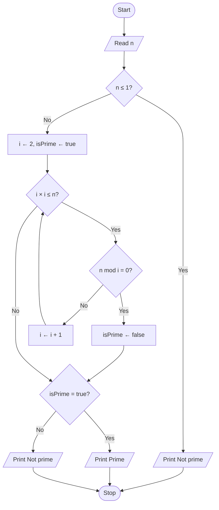

# Algorithm and Flowchart to Determine Whether a Given Number is Prime or Not

### 1. Problem Understanding

A **prime number** is a natural number greater than 1 that has exactly two positive factors: **1** and **itself**.

Examples:

| Number | Factors | Prime? |
|---|---|---|
| 2 | 1, 2 | Yes |
| 3 | 1, 3 | Yes |
| 4 | 1, 2, 4 | No |
| 17 | 1, 17 | Yes |
| 21 | 1, 3, 7, 21 | No |
| 29 | 1, 29 | Yes |
| 1 | 1 | No (only one factor) |
| 0 | — | No |
| Negative | — | No |

A number n is composite if it has a factor other than 1 and n. If n has a factor **d** such that `d × d ≤ n`, then it also has a paired factor `n / d` that is greater than or equal to `d`. Therefore, it is enough to test divisors up to **√n**.

### 2. Key Concepts Used

| Concept | Explanation |
|---|---|
| Prime number | Greater than 1 and divisible only by 1 and itself |
| Divisor | An integer that divides n with remainder 0 |
| Modulus operator | `n mod i = 0` means i divides n exactly |
| Loop bound | Testing up to √n is sufficient and efficient |
| Flag variable | `isPrime` records whether a factor was found |
| Early exit | Once a factor is found, no further checking is needed |

### 3. Algorithm (Step-by-Step)

1. Start.
2. Read the integer **n**.
3. If **n ≤ 1**, print "Not prime" and stop.
4. Set **i ← 2** and **isPrime ← true**.
5. While **i × i ≤ n**:
   - If **n mod i = 0**, then set **isPrime ← false** and exit the loop.
   - Otherwise, set **i ← i + 1**.
6. If **isPrime = true**, print "Prime"; otherwise print "Not prime".
7. Stop.

> **Shortcut:** If n = 2, the loop condition `2 × 2 ≤ 2` is false, so the algorithm correctly prints "Prime".

### 4. Flowchart



**Plain-text flowchart** (for viewers that do not render Mermaid):

```text
START
  │
  ▼
[Read n]
  │
  ▼
<n ≤ 1 ?> ──Yes──► [Print "Not prime"] ──► STOP
  │ No
  ▼
[i ← 2, isPrime ← true]
  │
  ▼
<i × i ≤ n ?> ──Yes──► <n mod i = 0 ?>
  ▲                        │ Yes              │ No
  │                        ▼                  ▼
  │                 [isPrime ← false]   [i ← i + 1]
  │                        │                  │
  │                        │                  └──► back to <i × i ≤ n ?>
  │ No                     │
  ▼                        │
<isPrime = true ?> ◄───────┘
  │ Yes              │ No
  ▼                  ▼
[Print "Prime"]  [Print "Not prime"]
  │                  │
  └────────┬─────────┘
           ▼
         STOP
```

### 5. Flowchart Explanation

| Step | Symbol | What happens |
|---|---|---|
| 1 | Oval | The process starts |
| 2 | Parallelogram | The integer n is read |
| 3 | Diamond | Checks whether n is 1 or less |
| 4 | Parallelogram | Such numbers are not prime, so the process stops |
| 5 | Rectangle | The divisor i starts at 2 and the flag is set to true |
| 6 | Diamond | Checks whether i × i is still within n |
| 7 | Diamond | Checks whether i divides n exactly |
| 8 | Rectangle | If yes, the flag becomes false and the loop is abandoned |
| 9 | Rectangle | If i does not divide n, i is increased by 1 |
| 10 | Diamond | After the loop, the flag is checked |
| 11 | Parallelogram | The final result (Prime / Not prime) is printed |
| 12 | Oval | The process stops |

### 6. Dry Run

**Input: n = 29**

| Iteration | i | i × i ≤ 29? | 29 mod i | Action |
|---|---|---|---|---|
| 1 | 2 | 4 ≤ 29 → Yes | 1 | i ← 3 |
| 2 | 3 | 9 ≤ 29 → Yes | 2 | i ← 4 |
| 3 | 4 | 16 ≤ 29 → Yes | 1 | i ← 5 |
| 4 | 5 | 25 ≤ 29 → Yes | 4 | i ← 6 |
| 5 | 6 | 36 ≤ 29 → No | — | Loop ends |

`isPrime` is still true → **29 is prime**.

**Input: n = 21**

| Iteration | i | i × i ≤ 21? | 21 mod i | Action |
|---|---|---|---|---|
| 1 | 2 | 4 ≤ 21 → Yes | 1 | i ← 3 |
| 2 | 3 | 9 ≤ 21 → Yes | 0 | Factor found → isPrime ← false |

The loop exits and the algorithm prints **21 is not prime**.

**Input: n = 1**

`n ≤ 1` is true → **Not prime**.

**Input: n = 2**

`i × i = 4 ≤ 2` is false, so the loop does not run. `isPrime` remains true → **2 is prime**.

### 7. Sample Input / Output

```
Enter a number: 29
29 is a prime number.
```

```
Enter a number: 21
21 is not a prime number.
```

```
Enter a number: 1
1 is not a prime number.
```

```
Enter a number: 2
2 is a prime number.
```

### 8. Edge Cases

| Input | Output | Remark |
|---|---|---|
| n = 0 | Not prime | 0 is neither prime nor composite |
| n = 1 | Not prime | Only one factor |
| n = 2 | Prime | The only even prime |
| n = 3 | Prime | Loop does not run |
| n = 4 | Not prime | Divisible by 2 |
| n = 49 | Not prime | 7 × 7; square of a prime |
| n = 97 | Prime | No divisor up to √97 ≈ 9.8 |
| n < 0 | Not prime | Primality is defined for natural numbers |
| Very large n | Correct but slow | Use a sieve or probabilistic test for very large values |

### 9. Common Mistakes to Avoid

1. **Checking all the way to n** — checking up to √n is enough and much faster.
2. **Forgetting the `n ≤ 1` case** — 0 and 1 are not prime.
3. **Treating 2 as composite** — if you skip even numbers, handle 2 separately.
4. **Using `i < n` without the square-root bound** — correct but inefficient for large n.
5. **Not stopping after finding a factor** — unnecessary work (though the result stays correct).
6. **Wrong loop condition** — `i × i ≤ n` is correct; `i × i < n` can misclassify squares of primes, e.g. 49.
7. **Overflow in `i × i`** — for extremely large n, use `i ≤ n / i` instead.
8. **Confusing "not divisible by 2" with "prime"** — many odd numbers are composite (e.g. 9, 15, 21).

### 10. Alternative Versions

**Counting factors:**

```text
START
    Read n
    count ← 0
    FOR i ← 1 TO n DO
        IF n mod i = 0 THEN count ← count + 1
    END FOR
    IF count = 2 THEN Print Prime ELSE Print Not prime
STOP
```

**Checking only 2 and odd numbers:**

```text
START
    Read n
    IF n ≤ 1 THEN Print Not prime; STOP
    IF n = 2 THEN Print Prime; STOP
    IF n mod 2 = 0 THEN Print Not prime; STOP
    i ← 3
    WHILE i × i ≤ n DO
        IF n mod i = 0 THEN Print Not prime; STOP
        i ← i + 2
    END WHILE
    Print Prime
STOP
```

**Sieve of Eratosthenes (for all primes up to N):**

```text
Create a list of numbers from 2 to N.
Repeatedly take the smallest unmarked number p and mark all multiples of p
(greater than p) as composite.
The unmarked numbers are prime.
```

### 11. Brief Result Table (for the lab record)

| n | Result | Reason |
|---|---|---|
| 0 | Not prime | Neither prime nor composite |
| 1 | Not prime | Only one factor |
| 2 | Prime | Only even prime |
| 3 | Prime | No divisor other than 1 and 3 |
| 4 | Not prime | Divisible by 2 |
| 17 | Prime | No divisor up to √17 |
| 21 | Not prime | 3 × 7 |
| 29 | Prime | No divisor up to √29 |
| 49 | Not prime | 7 × 7 |
| 97 | Prime | No divisor up to √97 |

---

⬅️ [Back to questions](question.md)
