# Algorithm and Flowchart to Determine Whether a Given Number is an Armstrong Number

### 1. Problem Understanding

An **Armstrong number** (also called a **narcissistic number** or **pluperfect digital invariant**) is a number that is equal to the sum of its own digits, each raised to the power of the number of digits.

If a number has **d** digits and its digits are `d₁, d₂, …, dₖ`, then it is an Armstrong number when:

```
n = d₁^d + d₂^d + ... + dₖ^d
```

Examples:

| Number | Digits | Calculation | Armstrong? |
|---|---|---|---|
| 153 | 3 | 1³ + 5³ + 3³ = 1 + 125 + 27 = 153 | Yes |
| 370 | 3 | 3³ + 7³ + 0³ = 27 + 343 + 0 = 370 | Yes |
| 371 | 3 | 3³ + 7³ + 1³ = 27 + 343 + 1 = 371 | Yes |
| 407 | 3 | 4³ + 0³ + 7³ = 64 + 0 + 343 = 407 | Yes |
| 1634 | 4 | 1⁴ + 6⁴ + 3⁴ + 4⁴ = 1 + 1296 + 81 + 256 = 1634 | Yes |
| 9474 | 4 | 9⁴ + 4⁴ + 7⁴ + 4⁴ = 6561 + 256 + 2401 + 256 = 9474 | Yes |
| 123 | 3 | 1³ + 2³ + 3³ = 1 + 8 + 27 = 36 ≠ 123 | No |

> **Important:** The exponent is the **number of digits**, not always 3. The "sum of cubes" rule works only for 3-digit numbers.

### 2. Key Concepts Used

| Concept | Explanation |
|---|---|
| Digit extraction | `n mod 10` gives the last digit |
| Digit removal | `n div 10` removes the last digit |
| Digit count | Count how many times the number can be divided by 10 |
| Power | Each digit is raised to the power `d` (the digit count) |
| Accumulator | `sum` collects the powered digits |
| Comparison | Compare the sum with the original number |
| Temporary variable | `temp` is used so that the original n is not destroyed |

### 3. Algorithm (Step-by-Step)

1. Start.
2. Read the integer **n**.
3. If **n < 0**, print "Not an Armstrong number" and stop. (Negative numbers are normally excluded.)
4. Set **temp ← n**, **count ← 0**.
5. While **temp ≠ 0**:
   - **count ← count + 1**
   - **temp ← temp div 10**
   *(This counts the number of digits.)*
6. Set **temp ← n**, **sum ← 0**.
7. While **temp ≠ 0**:
   - **d ← temp mod 10**
   - **sum ← sum + d^count**
   - **temp ← temp div 10**
8. If **sum = n**, print "Armstrong number"; otherwise print "Not an Armstrong number".
9. Stop.

### 4. Flowchart



<sub>Mermaid source: [`diagrams/answer7.mmd`](diagrams/answer7.mmd)</sub>

**Plain-text flowchart** (text fallback):

```text
START
  │
  ▼
[Read n]
  │
  ▼
<n < 0 ?> ──Yes──► [Print "Not an Armstrong number"] ──► STOP
  │ No
  ▼
[temp ← n, count ← 0]
  │
  ▼
<temp ≠ 0 ?> ──Yes──► [count ← count + 1]
  ▲                        │
  │                        ▼
  │                  [temp ← temp div 10]
  │                        │
  │                        └──► back to <temp ≠ 0 ?>
  │ No
  ▼
[temp ← n, sum ← 0]
  │
  ▼
<temp ≠ 0 ?> ──Yes──► [d ← temp mod 10]
  ▲                        │
  │                        ▼
  │                  [sum ← sum + d^count]
  │                        │
  │                        ▼
  │                  [temp ← temp div 10]
  │                        │
  │                        └──► back to <temp ≠ 0 ?>
  │ No
  ▼
<sum = n ?> ──Yes──► [Print "Armstrong number"] ──┐
  │ No                                              │
  ▼                                                 │
[Print "Not an Armstrong number"] ──────────────────┤
                                                    ▼
                                                  STOP
```

### 5. Flowchart Explanation

| Step | Symbol | What happens |
|---|---|---|
| 1 | Oval | The process starts |
| 2 | Parallelogram | The integer n is read |
| 3 | Diamond | Negative numbers are rejected |
| 4 | Rectangle | `temp` is set to n and the digit counter is set to 0 |
| 5 | Diamond | Loops until all digits are counted |
| 6 | Rectangle | Increments the digit count and removes the last digit of temp |
| 7 | Rectangle | temp is reset to n and the sum is set to 0 |
| 8 | Diamond | Loops over every digit of the number |
| 9 | Rectangle | Extracts the last digit |
| 10 | Rectangle | Adds the digit raised to the power `count` |
| 11 | Rectangle | Removes the last digit |
| 12 | Diamond | Compares the computed sum with the original number |
| 13 | Parallelogram | Prints whether the number is Armstrong or not |

### 6. Dry Run

**Input: n = 153**

*First loop — counting digits:*

| Iteration | temp | temp ≠ 0? | count | temp after div 10 |
|---|---|---|---|---|
| Start | 153 | Yes | 1 | 15 |
| 2 | 15 | Yes | 2 | 1 |
| 3 | 1 | Yes | 3 | 0 |
| 4 | 0 | No | 3 | — |

So `count = 3`.

*Second loop — summing powers:*

| Iteration | temp | d = temp mod 10 | d³ | sum | temp after div 10 |
|---|---|---|---|---|---|
| Start | 153 | 3 | 27 | 27 | 15 |
| 2 | 15 | 5 | 125 | 152 | 1 |
| 3 | 1 | 1 | 1 | 153 | 0 |
| 4 | 0 | — | — | 153 | — |

`sum = 153 = n` → **Armstrong number**.

**Input: n = 9474**

Digit count = 4.

| Digit | 9 | 4 | 7 | 4 |
|---|---|---|---|---|
| Digit⁴ | 6561 | 256 | 2401 | 256 |

Sum = 6561 + 256 + 2401 + 256 = **9474** → Armstrong.

**Input: n = 123**

Digit count = 3.

Sum = 1³ + 2³ + 3³ = 1 + 8 + 27 = **36 ≠ 123** → Not an Armstrong number.

### 7. Sample Input / Output

```
Enter a number: 153
153 is an Armstrong number.
```

```
Enter a number: 9474
9474 is an Armstrong number.
```

```
Enter a number: 123
123 is not an Armstrong number.
```

```
Enter a number: -153
-153 is not an Armstrong number.
```

### 8. Edge Cases

| Input | Result | Remark |
|---|---|---|
| 0 | Armstrong | 0¹ = 0; single-digit numbers are Armstrong |
| 5 | Armstrong | 5¹ = 5 |
| 9 | Armstrong | 9¹ = 9 |
| 10 | Not Armstrong | 1² + 0² = 1 ≠ 10 |
| 153 | Armstrong | 3-digit example |
| 9474 | Armstrong | 4-digit example |
| 123 | Not Armstrong | Sum is 36 |
| Negative number | Not Armstrong | Negative numbers are normally excluded |
| Very large number | Possible overflow | `d^count` can exceed integer range |

### 9. Common Mistakes to Avoid

1. **Always cubing the digits** — this only works for 3-digit numbers; use the actual digit count as the exponent.
2. **Losing the original number** — save it in `temp` or `original`, because the loops modify the working copy.
3. **Counting digits incorrectly** — the count loop must use a separate temporary variable.
4. **Using the wrong exponent** — the exponent is the total number of digits, not the position of the digit.
5. **Forgetting the negative check** — a negative number is not a standard Armstrong number.
6. **Integer overflow** — powers such as 9⁷ are large; use a wider data type when needed.
7. **Confusing Armstrong with palindrome** — an Armstrong number is about digit powers, a palindrome is about reversed order.

### 10. Alternative Versions

**For 3-digit numbers only (sum of cubes):**

```text
START
    Read n
    temp ← n
    sum ← 0
    WHILE temp ≠ 0 DO
        d ← temp mod 10
        sum ← sum + d × d × d
        temp ← temp div 10
    END WHILE
    IF sum = n THEN Print Armstrong ELSE Print Not Armstrong
STOP
```

**Using string conversion (pseudocode):**

```text
START
    Read n
    s ← convert n to string
    d ← length(s)
    sum ← 0
    FOR each character c IN s DO
        digit ← integer value of c
        sum ← sum + digit^d
    END FOR
    IF sum = n THEN Print Armstrong ELSE Print Not Armstrong
STOP
```

**Python one-liner idea:**

```python
n = int(input("Enter a number: "))
print(n == sum(int(d) ** len(str(n)) for d in str(n)))
```

### 11. Brief Result Table (for the lab record)

| n | Digit count | Sum of powers | Result |
|---|---|---|---|
| 0 | 1 | 0 | Armstrong |
| 5 | 1 | 5 | Armstrong |
| 153 | 3 | 153 | Armstrong |
| 370 | 3 | 370 | Armstrong |
| 371 | 3 | 371 | Armstrong |
| 407 | 3 | 407 | Armstrong |
| 9474 | 4 | 9474 | Armstrong |
| 123 | 3 | 36 | Not Armstrong |
| 10 | 2 | 1 | Not Armstrong |

---

⬅️ [Back to questions](question.md)
