# Algorithm and Flowchart to Generate the Fibonacci Series up to a Given Term

### 1. Problem Understanding

The **Fibonacci series** is a sequence in which every term (from the third term onward) is the sum of the two previous terms:

```
0, 1, 1, 2, 3, 5, 8, 13, 21, 34, ...
```

Mathematically:

```
F(0) = 0
F(1) = 1
F(n) = F(n − 1) + F(n − 2)     for n ≥ 2
```

In this answer, **"up to a given term"** is interpreted as **the first n terms** of the series. (An alternative interpretation — terms whose value does not exceed N — is given in Section 10.)

Examples:

| n (number of terms) | Fibonacci series |
|---|---|
| 1 | 0 |
| 2 | 0, 1 |
| 5 | 0, 1, 1, 2, 3 |
| 7 | 0, 1, 1, 2, 3, 5, 8 |
| 10 | 0, 1, 1, 2, 3, 5, 8, 13, 21, 34 |

### 2. Key Concepts Used

| Concept | Explanation |
|---|---|
| Sequence | An ordered list of numbers |
| Recurrence relation | Each term depends on the two previous terms |
| Two variables | `a` and `b` hold the last two terms |
| Temporary variable | `next` stores the sum before updating a and b |
| Counter | `count` tracks how many terms have been printed |
| Loop | Repeats until n terms are produced |

### 3. Algorithm (Step-by-Step)

1. Start.
2. Read the number of terms **n**.
3. If **n ≤ 0**, print "Invalid input" and stop.
4. Set **a ← 0**, **b ← 1**, **count ← 1**.
5. While **count ≤ n**:
   - Print **a**.
   - **next ← a + b**
   - **a ← b**
   - **b ← next**
   - **count ← count + 1**
6. Stop.

### 4. Flowchart



<sub>Mermaid source: [`diagrams/answer8.mmd`](diagrams/answer8.mmd)</sub>

**Plain-text flowchart** (text fallback):

```text
START
  │
  ▼
[Read n]
  │
  ▼
<n ≤ 0 ?> ──Yes──► [Print "Invalid input"] ──► STOP
  │ No
  ▼
[a ← 0, b ← 1, count ← 1]
  │
  ▼
<count ≤ n ?> ──Yes──► [Print a]
  ▲                        │
  │                        ▼
  │                  [next ← a + b]
  │                        │
  │                        ▼
  │                  [a ← b]
  │                        │
  │                        ▼
  │                  [b ← next]
  │                        │
  │                        ▼
  │                  [count ← count + 1]
  │                        │
  │                        └──► back to <count ≤ n ?>
  │ No
  ▼
STOP
```

### 5. Flowchart Explanation

| Step | Symbol | What happens |
|---|---|---|
| 1 | Oval | The process starts |
| 2 | Parallelogram | The number of terms n is read |
| 3 | Diamond | Rejects n ≤ 0 |
| 4 | Rectangle | The first two terms (0 and 1) and the counter are initialised |
| 5 | Diamond | Checks whether n terms have already been printed |
| 6 | Parallelogram | Prints the current term `a` |
| 7 | Rectangle | Computes the next term as `a + b` |
| 8 | Rectangle | Moves `b` into `a` |
| 9 | Rectangle | Moves the newly computed term into `b` |
| 10 | Rectangle | Increments the counter |
| 11 | Oval | The process stops after n terms are printed |

### 6. Dry Run

**Input: n = 7**

| Iteration | count | count ≤ 7? | Printed a | next = a + b | New a | New b |
|---|---|---|---|---|---|---|
| Start | 1 | Yes | 0 | 0 + 1 = 1 | 1 | 1 |
| 2 | 2 | Yes | 1 | 1 + 1 = 2 | 1 | 2 |
| 3 | 3 | Yes | 1 | 1 + 2 = 3 | 2 | 3 |
| 4 | 4 | Yes | 2 | 2 + 3 = 5 | 3 | 5 |
| 5 | 5 | Yes | 3 | 3 + 5 = 8 | 5 | 8 |
| 6 | 6 | Yes | 5 | 5 + 8 = 13 | 8 | 13 |
| 7 | 7 | Yes | 8 | 8 + 13 = 21 | 13 | 21 |
| 8 | 8 | No | Loop ends | — | — | — |

**Output:** `0 1 1 2 3 5 8`

**Input: n = 1**

The loop runs once and prints `0`.

**Input: n = 2**

The loop runs twice and prints `0 1`.

### 7. Sample Input / Output

```
How many terms? 7
Fibonacci series: 0 1 1 2 3 5 8
```

```
How many terms? 10
Fibonacci series: 0 1 1 2 3 5 8 13 21 34
```

```
How many terms? 0
Invalid input! n must be a positive integer.
```

### 8. Edge Cases

| Input | Output | Remark |
|---|---|---|
| n = 0 | Invalid input | At least one term is required |
| n = 1 | 0 | Only the first term |
| n = 2 | 0 1 | First two terms |
| n = 3 | 0 1 1 | First repeated value |
| n < 0 | Invalid input | Negative term count is meaningless |
| Very large n | Correct but slow | Values grow exponentially; use a big-integer type |
| Decimal n | Invalid | The number of terms must be an integer |

### 9. Common Mistakes to Avoid

1. **Printing `b` instead of `a`** — the first printed term must be 0.
2. **Updating `a` before computing `next`** — the sum would use the wrong value; compute `next` first.
3. **Forgetting the temporary variable** — updating `a` and `b` directly can lose a value.
4. **Off-by-one error** — make sure exactly n terms are printed.
5. **Not handling n = 1 or n = 2 separately** — the general loop already handles them, but check the output.
6. **Starting with 1, 1 instead of 0, 1** — that gives a valid variant, but it is not the standard series. State the convention clearly.
7. **Using recursion for large n** — naive recursion is extremely slow; iteration is preferred.
8. **Ignoring overflow** — Fibonacci numbers grow quickly; use `long long` or a big-integer library.

### 10. Alternative Versions

**Fibonacci terms up to a maximum value N:**

```text
START
    Read N
    a ← 0, b ← 1
    WHILE a ≤ N DO
        Print a
        next ← a + b
        a ← b
        b ← next
    END WHILE
STOP
```

**Using an array:**

```text
START
    Read n
    IF n ≤ 0 THEN Print error; STOP
    fib[0] ← 0
    IF n > 1 THEN fib[1] ← 1
    FOR i ← 2 TO n - 1 DO
        fib[i] ← fib[i - 1] + fib[i - 2]
    END FOR
    FOR i ← 0 TO n - 1 DO
        Print fib[i]
    END FOR
STOP
```

**Recursive definition:**

```text
FUNCTION fib(n)
    IF n = 0 THEN RETURN 0
    IF n = 1 THEN RETURN 1
    RETURN fib(n - 1) + fib(n - 2)
END FUNCTION
```

> The recursive version is elegant but has exponential time complexity without memoisation.

**Starting with 1, 1 (variant):**

```text
START
    Read n
    IF n ≤ 0 THEN Print error; STOP
    a ← 1, b ← 1
    IF n ≥ 1 THEN Print a
    IF n ≥ 2 THEN Print b
    FOR count ← 3 TO n DO
        next ← a + b
        Print next
        a ← b
        b ← next
    END FOR
STOP
```

### 11. Brief Result Table (for the lab record)

| n | Fibonacci series |
|---|---|
| 1 | 0 |
| 2 | 0, 1 |
| 3 | 0, 1, 1 |
| 5 | 0, 1, 1, 2, 3 |
| 7 | 0, 1, 1, 2, 3, 5, 8 |
| 10 | 0, 1, 1, 2, 3, 5, 8, 13, 21, 34 |
| 15 | 0, 1, 1, 2, 3, 5, 8, 13, 21, 34, 55, 89, 144, 233, 377 |

---

⬅️ [Back to questions](question.md)
