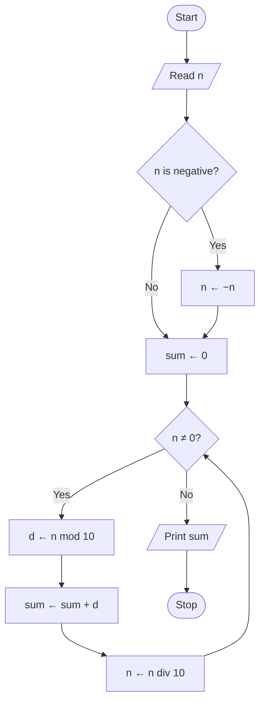

# Algorithm and Flowchart to Calculate the Sum of Digits of a Given Number

### 1. Problem Understanding

We must find the sum of all the digits of an integer.

Examples:

| Number | Digits | Sum |
|---|---|---|
| 1234 | 1, 2, 3, 4 | 10 |
| 9875 | 9, 8, 7, 5 | 29 |
| 0 | 0 | 0 |
| 7 | 7 | 7 |
| 1000 | 1, 0, 0, 0 | 1 |
| −456 | 4, 5, 6 | 15 (using the absolute value) |

The digits are extracted from right to left using two operations:

- **`n mod 10`** → gives the **last digit**
- **`n div 10`** → removes the **last digit**

This process repeats until the number becomes 0.

### 2. Key Concepts Used

| Concept | Explanation |
|---|---|
| Modulus operator | `n mod 10` extracts the last digit |
| Integer division | `n div 10` removes the last digit |
| Accumulator | `sum` stores the running total |
| Loop | Repeats until no digits remain |
| Negative handling | Use the absolute value so the minus sign is ignored |
| Termination | The loop ends when `n` becomes 0 |

### 3. Algorithm (Step-by-Step)

1. Start.
2. Read the integer **n**.
3. If **n < 0**, set **n ← −n** (use the absolute value).
4. Set **sum ← 0**.
5. While **n ≠ 0**:
   - **d ← n mod 10**
   - **sum ← sum + d**
   - **n ← n div 10**
6. Print **sum**.
7. Stop.

### 4. Flowchart



**Plain-text flowchart** (for viewers that do not render Mermaid):

```text
START
  │
  ▼
[Read n]
  │
  ▼
<n < 0 ?> ──Yes──► [n ← −n]
  │ No                  │
  ▼                     │
[sum ← 0] ◄─────────────┘
  │
  ▼
<n ≠ 0 ?> ──Yes──► [d ← n mod 10]
  ▲                        │
  │                        ▼
  │                  [sum ← sum + d]
  │                        │
  │                        ▼
  │                  [n ← n div 10]
  │                        │
  │                        └──► back to <n ≠ 0 ?>
  │ No
  ▼
[Print sum]
  │
  ▼
STOP
```

### 5. Flowchart Explanation

| Step | Symbol | What happens |
|---|---|---|
| 1 | Oval | The process starts |
| 2 | Parallelogram | The integer n is read |
| 3 | Diamond | Checks whether n is negative |
| 4 | Rectangle | If negative, the sign is removed |
| 5 | Rectangle | The sum is initialised to 0 |
| 6 | Diamond | Checks whether any digits remain |
| 7 | Rectangle | Extracts the last digit |
| 8 | Rectangle | Adds the digit to the sum |
| 9 | Rectangle | Removes the last digit from n |
| 10 | Parallelogram | When n becomes 0, the total sum is printed |
| 11 | Oval | The process stops |

### 6. Dry Run

**Input: n = 9875**

| Iteration | n | n ≠ 0? | d = n mod 10 | sum = sum + d | n after div 10 |
|---|---|---|---|---|---|
| Start | 9875 | Yes | 5 | 5 | 987 |
| 2 | 987 | Yes | 7 | 12 | 98 |
| 3 | 98 | Yes | 8 | 20 | 9 |
| 4 | 9 | Yes | 9 | 29 | 0 |
| 5 | 0 | No | — | 29 | — |

**Output:** `29`

**Input: n = 1234**

| Iteration | n | d | sum | n after div 10 |
|---|---|---|---|---|
| 1 | 1234 | 4 | 4 | 123 |
| 2 | 123 | 3 | 7 | 12 |
| 3 | 12 | 2 | 9 | 1 |
| 4 | 1 | 1 | 10 | 0 |

**Output:** `10`

**Input: n = 0**

The loop condition `0 ≠ 0` is false, so the loop does not run and the sum remains **0**.

**Input: n = −456**

The sign is removed, so n becomes 456. Digits 6 + 5 + 4 = **15**.

### 7. Sample Input / Output

```
Enter an integer: 9875
Sum of digits = 29
```

```
Enter an integer: 1234
Sum of digits = 10
```

```
Enter an integer: 0
Sum of digits = 0
```

```
Enter an integer: -456
Sum of digits = 15
```

### 8. Edge Cases

| Input | Result | Remark |
|---|---|---|
| 0 | 0 | The loop does not run |
| 7 | 7 | Single-digit number |
| 10 | 1 | Trailing zero contributes nothing |
| 1000 | 1 | Three zeros contribute nothing |
| −456 | 15 | Sign is ignored |
| 999999 | 54 | All digits are 9 |
| Very large number | Correct | May overflow if the sum is stored in a small type |
| Decimal number | Invalid | Input must be an integer |

### 9. Common Mistakes to Avoid

1. **Forgetting to update n** — `n = n div 10` is essential; otherwise the loop never ends.
2. **Initialising `sum` to 1** — use `sum = 0`.
3. **Using floating-point division** — `n / 10` keeps the fractional part; use integer division.
4. **Ignoring the minus sign** — a negative number would produce a negative digit; use the absolute value.
5. **Extracting digits in the wrong order** — the order does not matter for a sum, but the extraction method must be consistent.
6. **Trying to handle the number as a whole** — use the digit-by-digit loop.
7. **Overflow of the sum** — the sum of digits is small, but the number itself may need a wide type.

### 10. Alternative Versions

**Using string conversion:**

```text
START
    Read n
    s ← convert absolute value of n to string
    sum ← 0
    FOR each character c IN s DO
        sum ← sum + integer value of c
    END FOR
    Print sum
STOP
```

**Recursive version:**

```text
FUNCTION digit_sum(n)
    IF n = 0 THEN
        RETURN 0
    ELSE
        RETURN (n mod 10) + digit_sum(n div 10)
    END IF
END FUNCTION
```

**Digital root (repeated digit sum until one digit):**

```text
START
    Read n
    WHILE n ≥ 10 DO
        sum ← 0
        WHILE n ≠ 0 DO
            sum ← sum + (n mod 10)
            n ← n div 10
        END WHILE
        n ← sum
    END WHILE
    Print n
STOP
```

> The digital root can also be computed directly as `1 + ((n − 1) mod 9)` for n > 0.

### 11. Brief Result Table (for the lab record)

| n | Sum of digits |
|---|---|
| 0 | 0 |
| 7 | 7 |
| 10 | 1 |
| 1234 | 10 |
| 9875 | 29 |
| 1000 | 1 |
| 999999 | 54 |
| −456 | 15 |

---

⬅️ [Back to questions](question.md)
